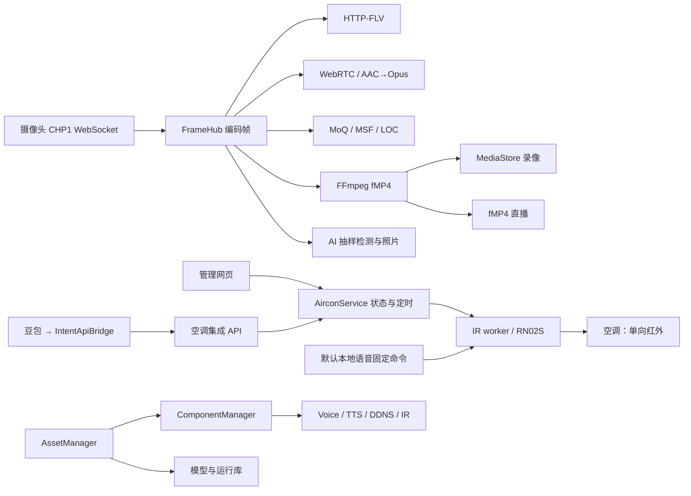

# camera-hub 工程分析与调整建议

分析日期：2026-10-12。源码基线：`25c9174ac8765e1d13a806dd40534e8b748ac7f8`。

## 修复跟踪

本文正文保留修复前的分析与行号；当前状态以本节为准。重复的模块报告、HTML、JSON清单及摘要已清理。

- `464b991` 已修复照片回传权限、录像清理归属、同秒覆盖、DDNS临时文件、设置并发保存、语音空调统一状态、自动关机容量与保存后发布、FLV取消、fMP4代次及TTS健康检查。
- 本轮修复组件启停互斥、维护期间最新意图、自启配置发布顺序、worker参数传递、WebRTC会话ID、RTP边界、前端迟到结果与评测取消、AI抓拍错误保留、部署工作区保护和程序切换回退。本地107项、MI6原生128项测试通过，浏览器五项竞态回归及隔离接口验证通过。release构建及部署进行中。
- 尚未修复：即时空调request_id持久去重、模型安装中断整组恢复、媒体源结束与时钟重建、QQ通知隔离及过期取消、非标准HTTPS公开端口。

本报告分析当前完整工程，包括 Rust 服务、浏览器端源码、MI6/Termux 部署脚本和模块之间的调用契约。主审查清单覆盖 67 个文件、31,143 行；前端清单以外的 manifest 也用于核对构建配置。排除第三方依赖实现、模型及其他二进制、锁文件正文和生成目录的重复审查。生成目录仅用于核对源码同步与构建结果。

证据来自实际源码、直接调用方、安装器生成的配置、现有测试，以及本机执行的检查。本文的具体温度、容量和并发顺序是代码路径的触发示例，不是线上事故或性能测量。未访问 MI6、启动生产服务、操作空调、发送 QQ 消息、修改凭据或部署代码。

## 1. 工程判断

工程已有清晰的功能分层：主服务组织业务与管理接口，worker 隔离音频、推理、红外和 DDNS；视频消费者共享编码帧，避免每种协议重新解码。当前最需要补齐的是**资源归属、控制状态一致性、完整生命周期和失败后的可恢复性**。

优先级最高的五项如下。P0 表示应首先消除的私有数据访问漏洞；P1 表示具有明确触发条件的功能或数据完整性问题。置信度表示源码证据完整程度，不代表问题在线上发生的频率。

| 次序 | 优先级 | 问题 | 实际影响 | 主要位置 |
| --- | --- | --- | --- | --- |
| 1 | P0 | 匿名设备连接回传历史照片 | 绕过照片页面鉴权，读取保留的私有 JPEG | [main.rs:455–469](file:///Users/bytedance/work/camera-hub/src/main.rs#L455-L469) |
| 2 | P1 | 录像清理遍历整个数据根目录 | 语音参考文件、照片及未知文件受录像保留策略删除 | [media.rs:420–469](file:///Users/bytedance/work/camera-hub/src/media.rs#L420-L469) |
| 3 | P1 | DDNS 配置和 state 共享临时文件 | 并发写入可能把运行状态覆盖到配置里，丢失配置字段 | [ddns.rs:897–901](file:///Users/bytedance/work/camera-hub/src/ddns.rs#L897-L901) |
| 4 | P1 | 默认语音空调动作直接访问 IR worker | 主服务的影子状态过时，后续相对温度操作错误 | [voice.rs:290–347](file:///Users/bytedance/work/camera-hub/src/voice.rs#L290-L347) |
| 5 | P1 | 红外发送后才检查自动关机容量 | 已发出开机指令，却没有用户要求的自动关机任务 | [aircon.rs:677–693](file:///Users/bytedance/work/camera-hub/src/aircon.rs#L677-L693) |

这五项是优先修复清单，其他已核对的失败路径和后续优化在第 4 节展开。当前工程适合围绕现有模块做局部调整；没有源码证据支持为此引入数据库、消息中间件、通用工作流框架或替换前端框架。

## 2. 当前架构与应保留的设计

### 2.1 主要链路

下图描述当前调用关系。默认本地语音绕过 AirconService 的路径，是状态不一致问题的来源。



主服务创建这些业务对象并组合路由的证据在 [main.rs:135–270](file:///Users/bytedance/work/camera-hub/src/main.rs#L135-L270)。帧分发在 [frames.rs:24–180](file:///Users/bytedance/work/camera-hub/src/frames.rs#L24-L180)，fMP4 消费和录像链路在 [mux.rs:208–267](file:///Users/bytedance/work/camera-hub/src/mux.rs#L208-L267)。

### 2.2 已经合理的部分

| 设计 | 保留理由 | 后续调整边界 |
| --- | --- | --- |
| 主服务与 worker 分离 | 硬件与原生库不必全部进入主服务；可独立管理组件 | 修复进程生命周期，不扩成分布式服务 |
| IR worker 只处理红外 | loopback 客户端、禁用代理和跳转、长度及发送节流等边界明确 | 主服务拥有业务状态；worker 保持传输职责 |
| 空调发送完整状态帧 | 相对命令先转绝对状态，避免把红外当成有反馈的事务 | 所有受管理入口共享同一影子状态 |
| `physical_confirmed=false` | 准确表达 RN02S 单向通信能力 | 不将“发送成功”描述为真实执行确认 |
| `Arc` 编码帧及有界广播 | 单个消费者不直接阻塞摄像头分发；内存增长有界 | 补齐断连、代次切换和消费者取消 |
| 原生推理跨进程锁 | 约束有限设备上的 AI、KWS/ASR、TTS 并行占用 | 先测等待时间和响应，再决定调度策略 |
| 模型下载验证与分阶段安装 | 固定资源、哈希与大小验证，异常返回时已有回滚 | 补齐进程中断后的恢复 |
| 前端源码与生成目录分离 | MI6 构建 Rust 时可直接嵌入静态资源，不强制安装 Node | 用构建比对保证源码与产物同步 |

对应证据：[IR 客户端边界](file:///Users/bytedance/work/camera-hub/src/ir_control.rs#L36-L66)、[红外发送边界](file:///Users/bytedance/work/camera-hub/src/workers/ir.rs#L92-L109)、[空调状态返回](file:///Users/bytedance/work/camera-hub/src/aircon.rs#L698-L710)、[推理锁](file:///Users/bytedance/work/camera-hub/src/inference_lock.rs)、[资源提交与回滚](file:///Users/bytedance/work/camera-hub/src/asset_manager.rs#L918-L978)、[前端构建](file:///Users/bytedance/work/camera-hub/web-src/build.mjs)。

灵活自然语言控制继续由豆包/IntentApiBridge 转换成参数化 API；本地固定 KWS 继续提供离线固定命令。ASR 当前发布转写，不负责执行推断出的意图；[voice-nlu.md](file:///Users/bytedance/work/camera-hub/docs/voice-nlu.md) 中的历史规则/LLM 方案不应被误认为已实现功能。

## 3. 优先修复的五项问题

### 3.1 P0：匿名上传通道可以读取私有照片

`/api/v1/devices/{id}/link` 是明确开放的上传入口。问题出在同一连接还会读取服务器已有照片并回传：只校验 ID 语法，没有验证该连接拥有此设备的数据读取权。

直接证据：[auth.rs:112–124,164](file:///Users/bytedance/work/camera-hub/src/auth.rs#L112-L164)、[main.rs:393–469](file:///Users/bytedance/work/camera-hub/src/main.rs#L393-L469)。关键代码：

```rust
let generation = state.begin_link(&device_id).await;
let mut photo_cursor = String::new();
// 后续定时分支
let root = state.config.data_dir.join(&device_id).join("snapshot");
let after = photo_cursor.clone();
let name = tokio::task::spawn_blocking(move || next_snapshot_name(&root, &after))
    .await
    .ok()
    .flatten();
// 读取 JPEG 后，在同一个匿名 socket 上发送 CHP1 照片包
```

最小触发条件是服务可达、知道或选中一个保留了有效照片的设备 ID。连接不需要先发送 hello 或视频，空游标会回传最新照片。提供合法较小游标 `00000000.jpg` 可以逐张获得游标之后的历史照片；空游标本身并不会自动遍历整个历史库。游标行为见 [main.rs:1535–1551](file:///Users/bytedance/work/camera-hub/src/main.rs#L1535-L1551)。

**调整建议：**保留业务需要的匿名上传，但历史照片回传增加独立的设备绑定凭据。如果暂时没有设备身份配置，先关闭公共连接上的私有照片回传。仅增加 hello、限制游标或依靠照片页面登录，都无法验证读取权。若进一步保护上传连接的替换权，也应使用设备身份而非只有 `device_id`。

### 3.2 P1：录像清理越过数据归属边界

`MediaStore` 接收整个 `config.data_dir`。清理器递归收集所有文件后，按年龄及空间预算删除；没有限定合法录像文件或所属目录。

关键代码来自 [media.rs:414–469](file:///Users/bytedance/work/camera-hub/src/media.rs#L414-L469)：

```rust
let mut files = Vec::new();
collect_files(root, &mut files)?;
// ...
for file in &files {
    if file.modified < cutoff && !protected(&file.path, current) {
        remove_pair(&file.path);
    }
}
```

MI6 安装配置明确使用 `camera-data` 作为总根目录，同时放入 `voice/events.jsonl` 与 `voice/tts`，并设置七天录像保留。证据见 [setup.rs:103–184](file:///Users/bytedance/work/camera-hub/src/setup.rs#L103-L184) 与 [setup.rs:188–190](file:///Users/bytedance/work/camera-hub/src/setup.rs#L188-L190)。因此未变化的默认语音 profile 参考文件超过七天，就可能被录像策略删除；这些 profile 并不受 TTS 的公共 profile 年龄策略限制。照片的独立数量策略同样会被覆盖。

清理不是必须运行一小时才发生：定时器第一次 tick 在启动后立即触发，见 [main.rs:1661–1678](file:///Users/bytedance/work/camera-hub/src/main.rs#L1661-L1678)。这说明触发风险，不代表当前 MI6 已丢失数据。

**调整建议：**录像清理只枚举设备的 record/spool 目录和经过验证的录像及索引；未知文件保留，目录符号链接不跟随。照片、TTS profile、缓存和事件文件由各自模块清理。先限定清理范围即可修复，无须立即迁移全部目录。

### 3.3 P1：DDNS 两种文档共用临时文件

关键代码来自 [ddns.rs:897–901](file:///Users/bytedance/work/camera-hub/src/ddns.rs#L897-L901)：

```rust
let temporary = path.with_extension("tmp");
fs::write(&temporary, serde_json::to_vec_pretty(value)?)?;
secure_file(&temporary)?;
fs::rename(&temporary, path)?;
```

`with_extension` 会替换扩展名，所以 MI6 配置中的：

```text
camera-hub-ddns.json  → camera-hub-ddns.tmp
camera-hub-ddns.state → camera-hub-ddns.tmp
```

这两个目标文件分别由主服务和 DDNS worker 写入。主服务写好配置临时文件后，worker 若写入 state，主服务再 rename，就把 state 内容当成配置提交。由于配置使用 `serde(default)`，缺失字段会变成默认的禁用状态、空凭据等，而不是可靠地拒绝错误文档。

安装器为这两个进程提供相同路径的依据在 [setup.rs:113–125](file:///Users/bytedance/work/camera-hub/src/setup.rs#L113-L125)。`camera-hub-ddns-status.json` 的临时文件是另一个名字，不属于本次碰撞。

**调整建议：**临时文件保留目标完整文件名，每次写入使用独立后缀，再原子 rename。配置与 state 的 schema 校验可作为补充，修复核心是消除共享临时路径。先做本地文件交错测试，无需调用 DNSPod。

### 3.4 P1：空调存在两个状态控制入口

管理网页和豆包集成调用 AirconService；默认本地语音却直接调用 IR worker。关键配置来自 [voice.rs:290–347](file:///Users/bytedance/work/camera-hub/src/voice.rs#L290-L347)：

```rust
url: format!("{base_url}/v1/actions/ac-on"),
// ac-cool / ac-dry / ac-off 同样直连 worker
```

下面的路径在文件系统与 worker 都正常时即可成立：

1. 主服务设置制冷 24℃，影子状态为已知 24℃。
2. 默认语音“制冷模式”发出固定制冷 26℃，但不更新主服务。
3. 豆包或网页再执行“升高一度”，AirconService 根据 24℃计算并发出 25℃。

固定动作温度见 [ir.rs:293–310](file:///Users/bytedance/work/camera-hub/src/ir.rs#L293-L310)，相对命令与状态更新见 [aircon.rs:138–147](file:///Users/bytedance/work/camera-hub/src/aircon.rs#L138-L147) 和 [aircon.rs:666–685](file:///Users/bytedance/work/camera-hub/src/aircon.rs#L666-L685)。

这是遗漏系统自己已知的发送结果，和手持遥控器操作后无法读取物理状态属于两种问题。

**调整建议：**默认受管理语音命令也进入 AirconService，统一命令排序、影子状态和调度。保留固定短语和已经验证的红外波形；IR worker 只做传输。如果仍保留直连，则必须同步有顺序的结果，或明确将影子状态置为未知，禁止继续默默依赖旧值做相对操作。用户自定义 URL 的语义应单独保留。

### 3.5 P1：完整空调请求未在发送前获得容量

关键代码来自 [aircon.rs:677–693](file:///Users/bytedance/work/camera-hub/src/aircon.rs#L677-L693)：

```rust
let transmission = self.ir.send_aircon(&next.to_ir_command()).await?;
// 更新影子状态后
let auto_off = if let Some(minutes) = auto_off_minutes {
    Some(store.add_schedule(
        AirconOperation::Off {},
        String::new(),
        epoch_seconds().saturating_add(u64::from(minutes) * 60),
        None,
    )?)
} else {
    // ...
};
```

以上片段省略了原代码的错误映射，保留实际操作顺序。活动任务上限为 128，Pending 与 Running 都计入容量，见 [aircon.rs:450–465](file:///Users/bytedance/work/camera-hub/src/aircon.rs#L450-L465)。

即时请求在已有 128 个活动任务时，会先发出开机，再发现自动关机任务无法创建。更明确的延时场景是：已有 127 个活动任务，接受一个带自动关机的开机任务成为第 128 个；它执行时仍占 Running 槽位，因此不需要并发请求就能使子任务创建失败。

**调整建议：**以“开机加自动关机”为完整接受单位，发送前预留全部容量。延时任务要在接受时预留子任务，或执行时原子转移父任务槽位。请求无法完整满足时，在产生红外副作用前拒绝。已发送后的失败也应保留真实发送结果。

## 4. 空调命令、持久化与重试

**预执行变更要保存成功后再发布。**`add_schedule` 先把任务插入当前内存文档再保存，保存失败没有撤销；调用方收到失败，任务却可能稍后执行。`run_due` 先改为 Running 再保存，保存失败会使一个没有发送过的任务停在 Running，之后扫描不再选择它。取消任务和修改 token 也有相同发布顺序。

证据：[aircon.rs:479–485](file:///Users/bytedance/work/camera-hub/src/aircon.rs#L479-L485)、[aircon.rs:543–549](file:///Users/bytedance/work/camera-hub/src/aircon.rs#L543-L549)、[aircon.rs:628–648](file:///Users/bytedance/work/camera-hub/src/aircon.rs#L628-L648)、[aircon.rs:717–726](file:///Users/bytedance/work/camera-hub/src/aircon.rs#L717-L726)。

在现有锁内构建候选文档，保存成功后替换内存文档即可。红外发送之后的保存失败要单独处理：发送已经产生副作用，不能简单回滚并重发。保留“已发送但未持久化”或“结果未知”，比把所有错误都视为未执行准确。

**即时命令需要明确 request_id 的重试语义。**当前即时分支丢弃 ID，延时分支却有去重。已知温度为 24℃时，同一个 ID 的 `+1` 请求成功接收两次，会发送 25℃和 26℃；即时开机加自动关机重试也可能生成多个任务。证据：[aircon.rs:556–609](file:///Users/bytedance/work/camera-hub/src/aircon.rs#L556-L609)。这说明内部语义不一致，不等于网络天然保证“恰好执行一次”。

建议在执行锁内保存有限的 ID、请求内容及结果记录：同 ID 同内容重放结果，同 ID 不同内容拒绝；明确记录保留和重启后的行为。遇到 worker 超时等未知结果时，也应保留未知状态而非自动重发相对命令。

**影子状态仍有物理局限。**统一入口能消除系统内部状态分歧，无法发现手持遥控器、信号遮挡或空调断电。`state_known` 表达本系统可追踪的指令状态；`physical_confirmed` 保持 false。真实反馈需要厂商协议、网关或额外传感器，不能仅通过修改红外 API 得到。

## 5. 视频源生命周期、时钟与录像

视频模块的主要缺口是源连接结束或重新开始时，消费者没有收到足够明确的通知。

| 已核对的路径 | 触发与后果 | 建议 |
| --- | --- | --- |
| [离线 FLV 等待](file:///Users/bytedance/work/camera-hub/src/flv_live.rs#L103-L166) | 客户端断开后没有新帧触发写入失败，任务继续持有许可；四个这样的任务占满全局四个 FLV 名额 | 将响应体关闭通知加入 select，设置源空闲退出条件 |
| [FLV 时间回退](file:///Users/bytedance/work/camera-hub/src/flv_live.rs#L425-L429) | 源 PTS 归零后仍用旧 origin，较小时间全部钳制为旧 last，时间长时间不推进 | 源代次变化时重连，或显式重建连续时间轴 |
| [FLV 音视频独立归零](file:///Users/bytedance/work/camera-hub/src/flv_live.rs#L254-L299) | 视频起点和首个音频帧分别归零，丢掉 FrameHub 已对齐的初始偏移 | 使用共同 origin，保留晚到音频的正偏移 |
| [fMP4 init 替换](file:///Users/bytedance/work/camera-hub/src/live.rs#L33-L41) | FFmpeg 重启只更新缓存 init，已有订阅仍用旧 init 接收新 fragment | 关闭旧订阅后重连，或广播 init/reset 事件 |
| [离线录像未关闭](file:///Users/bytedance/work/camera-hub/src/mux.rs#L151-L175) | 上传连接结束不关闭 muxer；最后录像索引未完成，一直受活动文件保护 | 当前源结束时关闭 FFmpeg、完成索引，或按最后帧回收 |
| [同秒录像名称](file:///Users/bytedance/work/camera-hub/src/media.rs#L332-L348) | 同秒两次开始使用同名文件，File::create 与 truncate 覆盖已有录像及索引 | 使用 create_new 与碰撞重试，保持文件名解析兼容 |
| [WebRTC 会话删除](file:///Users/bytedance/work/camera-hub/src/webrtc_live.rs#L68-L82) | B 替换 A 后，A 的迟到 DELETE 只带 device_id，关闭的是 B | offer 返回 session_id，删除时要求仍匹配该会话 |

源 PTS 回退由 [frames.rs:127–133](file:///Users/bytedance/work/camera-hub/src/frames.rs#L127-L133) 原样进入消费者；“每轨时间单调”测试不证明恢复或音视频同步正确。fMP4 订阅只发送一次 init 的调用方见 [main.rs:699–731](file:///Users/bytedance/work/camera-hub/src/main.rs#L699-L731)。上传退出路径见 [main.rs:407–488](file:///Users/bytedance/work/camera-hub/src/main.rs#L407-L488)，录像关闭与索引收尾见 [media.rs:369–385](file:///Users/bytedance/work/camera-hub/src/media.rs#L369-L385)。

共用契约只需要几个概念：源 generation、最后帧时间、结束原因、消费者取消。各协议继续拥有自己的时间轴和恢复逻辑，不必建立新的流媒体框架。已有上传 generation 检查、FLV IDR 恢复和 MoQ GOP 边界行为可继续使用。

[mux.rs:237–256](file:///Users/bytedance/work/camera-hub/src/mux.rs#L237-L256) 在广播 live fragment 前等待录像写入，磁盘错误会终止输出消费任务。需要明确录像失败时是否允许直播降级继续；muxer 父任务也要观察输出消费任务退出，避免 FFmpeg 仍存在却无人消费。是否分离写队列，应在测得磁盘阻塞后再决定。

## 6. worker 生命周期、资源安装与配置

**停止、等待退出和重启应属于同一个操作。**[component_manager.rs:455–463](file:///Users/bytedance/work/camera-hub/src/component_manager.rs#L455-L463) 取走 child 并设置继续运行意图后才等待退出；monitor 或并发 start 会看到可启动的空槽位。旧进程还未退出就可能启动替代进程，造成 Voice/DDNS 重叠，或 IR/TTS 端口占用。

逐组件操作锁或明确的 Stopping/Restarting 状态即可限制此路径。同一边界覆盖 API、monitor、资产安装暂停与恢复、服务退出。前端禁用按钮不能代替服务端互斥；恢复时还要尊重维护期间最新的用户意图。

**资产中断事务要在 worker 启动前恢复。**错误返回回滚无法处理进程被终止：target 移到 backup 后、stage 尚未全部安装时，可能留下缺失模型或不完整的模型/vocoder 组合。当前 startup 先启动 ComponentManager，后创建 AssetManager，没有恢复动作。证据：[main.rs:161–164](file:///Users/bytedance/work/camera-hub/src/main.rs#L161-L164)、[asset_manager.rs:305–309](file:///Users/bytedance/work/camera-hub/src/asset_manager.rs#L305-L309)、[asset_manager.rs:918–978](file:///Users/bytedance/work/camera-hub/src/asset_manager.rs#L918-L978)。

为一次 replacement set 保存少量事务信息，startup 先统一恢复旧版本或完成新版本，再 bootstrap worker。模型与 vocoder 作为一组决策；不能仅凭一个 target 存在就删除另一部分的旧备份。fsync 根据所需掉电保证决定。

**worker 参数从已解析的 Config 派生。**[component_manager.rs:413–429](file:///Users/bytedance/work/camera-hub/src/component_manager.rs#L413-L429) 仅启动 `current_exe worker <id>`，继承环境却不传主服务解析后的 CLI 参数。MI6 setup 环境启动通常掩盖问题；通用部署或 CLI 覆盖环境时，主服务与 worker 可能读写不同路径。显式传递角色所需的路径、URL、bind 和 token，同时保留 worker 专属配置即可。

## 7. TTS、语音与 AI

**健康检查不应等待模型锁。**[TTS health](file:///Users/bytedance/work/camera-hub/src/workers/tts.rs#L205-L215) 使用同步 mutex；[生成任务](file:///Users/bytedance/work/camera-hub/src/workers/tts.rs#L372-L393) 持有同一锁执行原生推理。忙时 health 无法及时返回 busy；超过管理器三秒 timeout 时显示为 unhealthy/starting，也影响依赖 TTS 的语音启动判断。

使用独立 loaded 标志或 try_lock 的 busy 分支即可解决。实际 MI6 推理时长尚未测量；没有源码证据显示管理器会因这一次 health 超时自动杀掉并重启仍存活的 TTS 进程。

**默认声纹变更与配置 revision 需要恢复协调。**[voice.rs:225–259](file:///Users/bytedance/work/camera-hub/src/voice.rs#L225-L259) 先完成 TTS profile 登记/删除，再保存主服务配置。后者失败时，profile 已变化而 revision 仍旧，首次克隆可能不激活，替换后预热也可能不发生。按默认 profile 的存在性及 fingerprint 做可恢复协调，或提供明确提交/回滚边界。

**按测量优化推理体验。**缓存未命中的 TTS 暂停 KWS/YOLO 是 [README 声明](file:///Users/bytedance/work/camera-hub/README.md#L358-L362) 的资源策略。先记录锁等待、模型加载、生成、缓存命中和 KWS 暂停时长，再决定预热、缓存或外置 TTS。保留当前公共匿名 TTS 和全局容量限制。

**AI 状态保留实际失败阶段。**[ai.rs:289–297](file:///Users/bytedance/work/camera-hub/src/ai.rs#L289-L297) 写入 snapshot 错误后，随即在成功推理更新中清空，导致拍照失败难以解释。分别记录 decode/inference/snapshot 错误，或在所有已尝试阶段成功后清空。如果运行中安装 AI 模型是目标功能，再增加受控重启。

空 token 配置下公共 TTS session 签名 key 每次主服务启动随机生成，旧 session 失效；正常 setup 非空 token 模式通常不受影响。该边缘配置可使用独立持久 key 或明确文档限制，证据在 [voice_studio.rs:31–34](file:///Users/bytedance/work/camera-hub/src/voice_studio.rs#L31-L34)。

## 8. 前端异步操作与管理状态

已有 `liveSession` 和 `playbackEpoch`，但创建及检查位置不一致。实际函数的 Node 受控调用观察到两条路径：A 照片请求晚于切换 B 返回，B 的选择配上 A 文件名；A 录像在 SourceOpen 等待期间取消，旧操作仍调用 native fallback。

| 操作 | 当前缺口 | 调整 |
| --- | --- | --- |
| [照片、日期、录像加载](file:///Users/bytedance/work/camera-hub/web-src/static/app.js#L2217-L2368) | await 后按当前选择写入旧结果 | 捕获 device/date/generation，结果、错误与动作都检查归属 |
| [录像播放](file:///Users/bytedance/work/camera-hub/web-src/static/app.js#L2906-L2917) | epoch 不匹配也进入 fallback，恢复已取消旧录像 | 过时操作直接返回，仅当前操作失败可降级 |
| [MoQ/WebRTC 启动](file:///Users/bytedance/work/camera-hub/web-src/static/app.js#L3345-L3421) | await 后才创建代次，或旧 catch 改写新播放器状态 | 首次 await 前创建代次，成功/catch/finally 都检查 |
| [多协议评测](file:///Users/bytedance/work/camera-hub/web-src/evaluation.ts#L599-L660) | preparing 时 stop 无法取消，重复点击可启动多套资源 | preparing 作为活动阶段，提前禁用开始，可被 stop 撤销 |

AbortController 减少不需要的请求；generation 检查阻止迟到结果，即使无法取消也保留。peer、SourceBuffer、timer 属于创建它的操作，旧操作只能清理自己的资源。

从 `app.js` 抽出资源加载和播放器生命周期，继续使用 player `create()/stop()`，无需先迁移框架。文件约 3,924 行，但长度本身不是缺陷；拆分目标是让操作归属容易验证。

轮询围绕当前视图展开，状态数据与配置草稿分开，避免保护草稿时冻结 QQ/DDNS 状态。保存期间继续编辑时，用表单 revision 判断已提交版本。以上交互改善尚未逐项做真实浏览器复现。

## 9. QQ、设置与传输配置

**QQ socket 循环不要等待通知 HTTP。**[qq.rs:784–862](file:///Users/bytedance/work/camera-hub/src/qq.rs#L784-L862) 在 select 分支 await 顺序分片发送，期间 heartbeat、ACK、配置变化及刷新不推进。源码证明本地阻塞，远端何时断开没有测量。使用一个有界发送任务回传结果，Gateway 保持 socket 单一所有者，凭据与取消绑定当前 session。

**超时排队通知不要继续开始发送。**[qq.rs:527–533](file:///Users/bytedance/work/camera-hub/src/qq.rs#L527-L533) 的 120 秒 timeout 只停止等待，没有撤销队列任务。增加绝对 deadline，出队和分片前检查；已开始发送区分部分成功与未知结果。不可撤销在途请求与可跳过过期排队任务需分别处理。

**设置更新覆盖整个读改写。**[settings.rs:175–197](file:///Users/bytedance/work/camera-hub/src/settings.rs#L175-L197) 读取快照后释放读锁，保存后才写回；并发 patch 会丢字段，也争用相同临时文件。用 store 写锁覆盖读取、应用、保存、发布，无需数据库。组件 autostart 同样应保存成功后发布。

**公开 HTTPS 地址带端口。**[auth.rs:216–224](file:///Users/bytedance/work/camera-hub/src/auth.rs#L216-L224) 重定向隐含 443；[Termux 配置](file:///Users/bytedance/work/camera-hub/deploy/termux/install.sh#L67-L70) 使用 HTTPS 8443。配置 public origin/authority，与 bind 分开。支持自定义 MoQ 端口时，也由服务端提供公开地址。

管理网页和独立集成 token 边界继续保留。未检查线上凭据，没有证据表明 MI6 使用默认账号密码。

## 10. 性能测量

当前缺少 MI6 CPU、RSS、播放延迟及识别准确率的实测数据。以下为下一次测量的问题，不是已知瓶颈，也没有预设改善百分比。

| 范围 | 应记录的数据 | 支持的决策 |
| --- | --- | --- |
| 多协议直播 | 首帧、可播放时间、播放端延迟、断流恢复、丢帧及 A/V 偏移 | 默认协议与重连恢复 |
| 录像 | fragment 写入耗时、错误、FFmpeg 数量、离线进程残留 | 录像/live 隔离与回收 |
| 语音/TTS | 锁等待、加载/生成、命中率、口令响应、误触发及漏识别 | 缓存、预热、线程数、外置 TTS |
| worker | 活动 PID、退出/restart 原因、探针耗时、backoff | 生命周期与失败预算 |
| 前端 | 当前页请求量、播放器/timer 数量、迟到响应 | 视图轮询与资源释放 |

[evaluation.ts](file:///Users/bytedance/work/camera-hub/web-src/evaluation.ts) 和 [benchmark.rs](file:///Users/bytedance/work/camera-hub/src/benchmark.rs) 可复用；先修操作归属，避免播放器竞态干扰协议比较。观测先用结构化日志与少量 status 字段；关联 request_id、任务 ID、源 generation 或 worker 操作即可，无需大型监控系统。

## 11. Git、发布与文档

按项目约定，MI6 为修改、提交与 push 源端，本机拉取。[mi6-deploy.sh:34–43](file:///Users/bytedance/work/camera-hub/scripts/dev/mi6-deploy.sh#L34-L43) 用本机源码 `rsync --delete` 覆盖 MI6 authoring checkout，同时排除 `.git`，可能删除待提交修改且不更新 HEAD。未检查远端未提交内容，没有声称已经丢失工作。

构建入口接收明确 commit，使用干净 checkout/worktree；实验 rsync 进入独立 staging。发布脚本处理二进制、库、音频路由、端口及启动配置，不替代源码流转。

安装器先复制 binary/shared library，后停止旧服务。版本目录中准备完整内容，检查后停止、切换、启动，失败切回旧版可减少混用。证据：[install.sh:28–37](file:///Users/bytedance/work/camera-hub/deploy/mi6/install.sh#L28-L37) 和 [install.sh:170–222](file:///Users/bytedance/work/camera-hub/deploy/mi6/install.sh#L170-L222)。未做设备升级实验。

构建使用锁文件，记录 commit、feature、运行库 ABI 和资源版本。MI6 已有 `--locked`、固定资源 hash 及 WebRTC revision；Termux和通用示例应一致。CI 构建前端并比较 `web/`，继续支持设备无需 Node 的方式。

文档优先澄清外部 NLU 归属、红外影子状态及物理反馈、不同 profile 的路径与公开端口，避免把历史方案或通用默认配置当成 MI6 运行事实。

## 12. 建议实施顺序

| 阶段 | 内容 | 验收 |
| --- | --- | --- |
| 1：数据与配置 | 照片回传权限、清理归属、DDNS 临时文件 | 匿名不能读私有照片；非录像保留；两种文档并发完整 |
| 2：空调可靠性 | 语音统一入口、完整容量、保存后发布、即时 ID | 状态一致；拒绝零发送；失败任务不执行；重试不重复 |
| 3：进程与资产 | 串行操作、Config 传递、startup 恢复、TTS health | 每组件至多一个 child；路径一致；模型完整；探针及时 |
| 4：媒体与界面 | 源结束、时钟、录像收尾、session ID、前端 generation | 断连回收；重连播放；旧操作不影响新会话 |
| 5：测量与发布 | 有限观测、生成同步、明确 commit 发布、文档 | 指标可复查；发布可追溯；源端工作区不被覆盖 |

各阶段拆成小提交，每个提交验证明确行为，再扩到下一阶段。没有设备数据，不提供虚构工期或性能收益。

## 13. 优先回归场景

以下是后续实施建议，**本次未生成或执行这些新测试**。

| 范围 | 可控输入 | 必须验证 |
| --- | --- | --- |
| 照片 | 两张有效 JPEG，匿名 link 空/较小游标 | 无读取凭据不回私有字节 |
| 清理 | 旧录像、照片、默认声纹、事件、未知文件，年龄/容量分别触发 | 仅归属录像删除，symlink 外部保留 |
| DDNS | barrier 固定 config/state 临时写与 rename 交错 | 两文档 schema/字段完整 |
| 语音空调 | mock：24℃→默认 cool→+1 | 影子26℃，后续27℃，或未知明确拒绝 |
| 自动关机 | 128 任务即时；127 后延时请求 | 不可完整满足零发送，延时子容量可靠 |
| 保存失败 | 创建/取消/claim 注入写或 rename 失败再恢复 | 拒绝不执行；claim可恢复；发送后不盲重试 |
| 即时 ID | 同 ID +1 两次；再同 ID 不同内容 | 一次发送、冲突拒绝 |
| worker | fake child TERM 后 barrier；restart/monitor/start/stop | reaped 前不替换，最新停止意图生效 |
| 资产 | 每次 rename 后模拟中断并初始化 | worker 前恢复完整旧/新组合 |
| TTS health | fake generation 持锁超过三秒 | 及时 loaded/busy |
| 媒体 | 离线 FLV 开关四次；PTS回退；新init；同秒roll | 许可释放、时间恢复、init正确、不覆盖 |
| 前端 | A晚于B；取消SourceOpen；离开preparing | A不覆盖B；旧fallback不执行；无残留资源 |
| QQ | 慢HTTP及过期排队 | heartbeat继续；未开始过期不发送 |

可用临时目录、mock HTTP、fake child和可控浏览器响应完成，集成资产统一放 `tests/integration/`；算法测试继续留在模块内。

## 14. 本次验证与限制

| 检查 | 结果 | 边界 |
| --- | --- | --- |
| `cargo +1.94.1 test --locked` | 6 library +84 main，共90通过 | 默认feature，未启用voice-workers |
| Rust fmt检查 | 通过 | 格式 |
| 全目标 Clippy `-D warnings` | 未通过：binary15项、test17项，有重叠 | 多为现有风格/简化等lint，不据数量推断功能故障 |
| `npm run check` | 通过 | TS覆盖，手写app.js大部分不在类型检查 |
| `npm run build` | 通过，tracked产物无变化 | 源码/产物同步 |
| JavaScript与shell语法 | 通过 | 不包含设备运行 |
| 实际前端函数受控Node调用 | 观察到迟到列表覆盖、取消后fallback | 非真实浏览器E2E |
| 四组源码审查与跨组核对 | 完成 | 静态路径与直接契约 |

未验证MI6实际环境、磁盘年龄/容量、原生推理与识别率、Android音频、真实播放、TLS/网络、QQ/DNSPod外部行为、掉电恢复。源码证明的操作顺序不依赖这些测量，但线上频率和性能判断受此限制。

本次仅增加审查文档，未修改业务代码、提交Git、推送或部署。检查日志位于临时目录 `/tmp/camera-hub-review-20261012/`。

修复状态以文首“修复跟踪”为准，生成报告和重复附件已清理。
