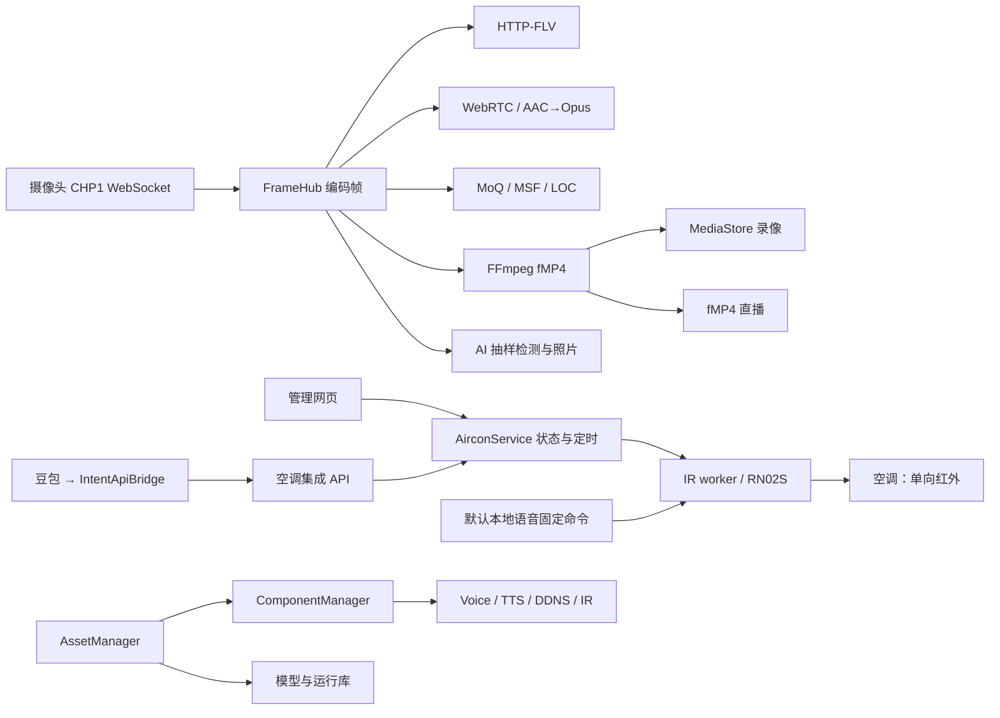

# camera-hub 工程分析与调整建议

分析日期：2026-10-12。源码基线：`25c9174ac8765e1d13a806dd40534e8b748ac7f8`。

## 修复跟踪

本文保留修复前的源码分析，正文行号和“未验证”描述对应上述基线，不代表当前版本仍存在所有问题。重复的模块报告、HTML、JSON清单及摘要已清理，后续进展集中记录在本文件。

- `464b991`：已修复照片回传权限、录像清理归属与同秒文件覆盖、DDNS临时文件冲突、设置并发保存、默认语音空调状态一致性、自动关机容量与保存后发布、FLV取消、fMP4代次和TTS健康检查。本地102项、MI6原生122项测试通过。
- `799c501`：修复组件启停互斥、维护期间最新意图、自启配置保存后发布、worker参数传递、WebRTC会话ID、畸形RTP包边界、前端迟到列表/播放器/评测启动、AI抓拍失败信息、部署脚本工作区保护及程序切换回退。本地107项、MI6原生128项测试通过；浏览器五项竞态回归、隔离接口验证、前端检查和构建通过。已部署MI6，四个worker健康，摄像头在线，录像字节增长；安装程序与release构建SHA-256一致，保留上一版程序。
- 仍需独立设计与验证：即时空调request_id持久去重、模型安装中断后的整组恢复、媒体源结束与时钟重建、QQ发送任务隔离和过期取消、非标准HTTPS公开端口配置。上述项目未列为本轮已完成。

本报告分析当前完整工程，包括 Rust 服务、浏览器端源码、MI6/Termux 部署脚本和模块之间的调用契约。主审查清单覆盖 67 个文件、31,143 行；前端清单以外的 manifest 也用于核对构建配置。排除第三方依赖实现、模型及其他二进制、锁文件正文和生成目录的重复审查。生成目录仅用于核对源码同步与构建结果。

证据来自实际源码、直接调用方、安装器生成的配置、现有测试，以及本机执行的检查。本文的具体温度、容量和并发顺序是代码路径的触发示例，不是线上事故或性能测量。未访问 MI6、启动生产服务、操作空调、发送 QQ 消息、修改凭据或部署代码。

## 1. 工程判断

工程已有清晰的功能分层：主服务组织业务与管理接口，worker 隔离音频、推理、红外和 DDNS；视频消费者共享编码帧，避免每种协议重新解码。当前最需要补齐的是**资源归属、控制状态一致性、完整生命周期和失败后的可恢复性**。

优先级最高的五项如下。P0 表示应首先消除的私有数据访问漏洞；P1 表示具有明确触发条件的功能或数据完整性问题。置信度表示源码证据完整程度，不代表问题在线上发生的频率。

| 次序 | 优先级 | 问题 | 实际影响 | 主要位置 |
| --- | --- | --- | --- | --- |
| 1 | P0 | 匿名设备连接回传历史照片 | 绕过照片页面鉴权，读取保留的私有 JPEG | [main.rs:455–469](file:///Users/bytedance/work/camera-hub/src/main.rs#L455-L469) |
| 2 | P1 | 录像清理遍历整个数据根目录 | 语音参考文件、照片及未知文件受录像保留策略删除 | [media.rs:420–469](file:///Users/bytedance/work/camera-hub/src/media.rs#L420-L469) |
| 3 | P1 | DDNS 配置和 state 共享临时文件 | 并发写入可能把运行状态覆盖到配置里，丢失配置字段 | [ddns.rs:897–901](file:///Users/bytedance/work/camera-hub/src/ddns.rs#L897-L901) |
| 4 | P1 | 默认语音空调动作直接访问 IR worker | 主服务的影子状态过时，后续相对温度操作错误 | [voice.rs:290–347](file:///Users/bytedance/work/camera-hub/src/voice.rs#L290-L347) |
| 5 | P1 | 红外发送后才检查自动关机容量 | 已发出开机指令，却没有用户要求的自动关机任务 | [aircon.rs:677–693](file:///Users/bytedance/work/camera-hub/src/aircon.rs#L677-L693) |

这五项是优先修复清单，其他已核对的失败路径和后续优化在第 4 节展开。当前工程适合围绕现有模块做局部调整；没有源码证据支持为此引入数据库、消息中间件、通用工作流框架或替换前端框架。

## 2. 当前架构与应保留的设计

### 2.1 主要链路

下图描述当前调用关系。默认本地语音绕过 AirconService 的路径，是状态不一致问题的来源。



主服务创建这些业务对象并组合路由的证据在 [main.rs:135–270](file:///Users/bytedance/work/camera-hub/src/main.rs#L135-L270)。帧分发在 [frames.rs:24–180](file:///Users/bytedance/work/camera-hub/src/frames.rs#L24-L180)，fMP4 消费和录像链路在 [mux.rs:208–267](file:///Users/bytedance/work/camera-hub/src/mux.rs#L208-L267)。

### 2.2 已经合理的部分

| 设计 | 保留理由 | 后续调整边界 |
| --- | --- | --- |
| 主服务与 worker 分离 | 硬件与原生库不必全部进入主服务；可独立管理组件 | 修复进程生命周期，不扩成分布式服务 |
| IR worker 只处理红外 | loopback 客户端、禁用代理和跳转、长度及发送节流等边界明确 | 主服务拥有业务状态；worker 保持传输职责 |
| 空调发送完整状态帧 | 相对命令先转绝对状态，避免把红外当成有反馈的事务 | 所有受管理入口共享同一影子状态 |
| `physical_confirmed=false` | 准确表达 RN02S 单向通信能力 | 不将“发送成功”描述为真实执行确认 |
| `Arc` 编码帧及有界广播 | 单个消费者不直接阻塞摄像头分发；内存增长有界 | 补齐断连、代次切换和消费者取消 |
| 原生推理跨进程锁 | 约束有限设备上的 AI、KWS/ASR、TTS 并行占用 | 先测等待时间和响应，再决定调度策略 |
| 模型下载验证与分阶段安装 | 固定资源、哈希与大小验证，异常返回时已有回滚 | 补齐进程中断后的恢复 |
| 前端源码与生成目录分离 | MI6 构建 Rust 时可直接嵌入静态资源，不强制安装 Node | 用构建比对保证源码与产物同步 |

对应证据：[IR 客户端边界](file:///Users/bytedance/work/camera-hub/src/ir_control.rs#L36-L66)、[红外发送边界](file:///Users/bytedance/work/camera-hub/src/workers/ir.rs#L92-L109)、[空调状态返回](file:///Users/bytedance/work/camera-hub/src/aircon.rs#L698-L710)、[推理锁](file:///Users/bytedance/work/camera-hub/src/inference_lock.rs)、[资源提交与回滚](file:///Users/bytedance/work/camera-hub/src/asset_manager.rs#L918-L978)、[前端构建](file:///Users/bytedance/work/camera-hub/web-src/build.mjs)。

灵活自然语言控制继续由豆包/IntentApiBridge 转换成参数化 API；本地固定 KWS 继续提供离线固定命令。ASR 当前发布转写，不负责执行推断出的意图；[voice-nlu.md](file:///Users/bytedance/work/camera-hub/docs/voice-nlu.md) 中的历史规则/LLM 方案不应被误认为已实现功能。

## 3. 优先修复的五项问题

### 3.1 P0：匿名上传通道可以读取私有照片

`/api/v1/devices/{id}/link` 是明确开放的上传入口。问题出在同一连接还会读取服务器已有照片并回传：只校验 ID 语法，没有验证该连接拥有此设备的数据读取权。

直接证据：[auth.rs:112–124,164](file:///Users/bytedance/work/camera-hub/src/auth.rs#L112-L164)、[main.rs:393–469](file:///Users/bytedance/work/camera-hub/src/main.rs#L393-L469)。关键代码：

```rust
let generation = state.begin_link(&device_id).await;
let mut photo_cursor = String::new();
// 后续定时分支
let root = state.config.data_dir.join(&device_id).join("snapshot");
let after = photo_cursor.clone();
let name = tokio::task::spawn_blocking(move || next_snapshot_name(&root, &after))
    .await
    .ok()
    .flatten();
// 读取 JPEG 后，在同一个匿名 socket 上发送 CHP1 照片包
```

最小触发条件是服务可达、知道或选中一个保留了有效照片的设备 ID。连接不需要先发送 hello 或视频，空游标会回传最新照片。提供合法较小游标 `00000000.jpg` 可以逐张获得游标之后的历史照片；空游标本身并不会自动遍历整个历史库。游标行为见 [main.rs:1535–1551](file:///Users/bytedance/work/camera-hub/src/main.rs#L1535-L1551)。

**调整建议：**保留业务需要的匿名上传，但历史照片回传增加独立的设备绑定凭据。如果暂时没有设备身份配置，先关闭公共连接上的私有照片回传。仅增加 hello、限制游标或依靠照片页面登录，都无法验证读取权。若进一步保护上传连接的替换权，也应使用设备身份而非只有 `device_id`。

### 3.2 P1：录像清理越过数据归属边界

`MediaStore` 接收整个 `config.data_dir`。清理器递归收集所有文件后，按年龄及空间预算删除；没有限定合法录像文件或所属目录。

关键代码来自 [media.rs:414–469](file:///Users/bytedance/work/camera-hub/src/media.rs#L414-L469)：

```rust
let mut files = Vec::new();
collect_files(root, &mut files)?;
// ...
for file in &files {
    if file.modified < cutoff && !protected(&file.path, current) {
        remove_pair(&file.path);
    }
}
```

MI6 安装配置明确使用 `camera-data` 作为总根目录，同时放入 `voice/events.jsonl` 与 `voice/tts`，并设置七天录像保留。证据见 [setup.rs:103–184](file:///Users/bytedance/work/camera-hub/src/setup.rs#L103-L184) 与 [setup.rs:188–190](file:///Users/bytedance/work/camera-hub/src/setup.rs#L188-L190)。因此未变化的默认语音 profile 参考文件超过七天，就可能被录像策略删除；这些 profile 并不受 TTS 的公共 profile 年龄策略限制。照片的独立数量策略同样会被覆盖。

清理不是必须运行一小时才发生：定时器第一次 tick 在启动后立即触发，见 [main.rs:1661–1678](file:///Users/bytedance/work/camera-hub/src/main.rs#L1661-L1678)。这说明触发风险，不代表当前 MI6 已丢失数据。

**调整建议：**录像清理只枚举设备的 record/spool 目录和经过验证的录像及索引；未知文件保留，目录符号链接不跟随。照片、TTS profile、缓存和事件文件由各自模块清理。先限定清理范围即可修复，无须立即迁移全部目录。

### 3.3 P1：DDNS 两种文档共用临时文件

关键代码来自 [ddns.rs:897–901](file:///Users/bytedance/work/camera-hub/src/ddns.rs#L897-L901)：

```rust
let temporary = path.with_extension("tmp");
fs::write(&temporary, serde_json::to_vec_pretty(value)?)?;
secure_file(&temporary)?;
fs::rename(&temporary, path)?;
```

`with_extension` 会替换扩展名，所以 MI6 配置中的：

```text
camera-hub-ddns.json  → camera-hub-ddns.tmp
camera-hub-ddns.state → camera-hub-ddns.tmp
```

这两个目标文件分别由主服务和 DDNS worker 写入。主服务写好配置临时文件后，worker 若写入 state，主服务再 rename，就把 state 内容当成配置提交。由于配置使用 `serde(default)`，缺失字段会变成默认的禁用状态、空凭据等，而不是可靠地拒绝错误文档。

安装器为这两个进程提供相同路径的依据在 [setup.rs:113–125](file:///Users/bytedance/work/camera-hub/src/setup.rs#L113-L125)。`camera-hub-ddns-status.json` 的临时文件是另一个名字，不属于本次碰撞。

**调整建议：**临时文件保留目标完整文件名，每次写入使用独立后缀，再原子 rename。配置与 state 的 schema 校验可作为补充，修复核心是消除共享临时路径。先做本地文件交错测试，无需调用 DNSPod。

### 3.4 P1：空调存在两个状态控制入口

管理网页和豆包集成调用 AirconService；默认本地语音却直接调用 IR worker。关键配置来自 [voice.rs:290–347](file:///Users/bytedance/work/camera-hub/src/voice.rs#L290-L347)：

```rust
url: format!("{base_url}/v1/actions/ac-on"),
// ac-cool / ac-dry / ac-off 同样直连 worker
```

下面的路径在文件系统与 worker 都正常时即可成立：

1. 主服务设置制冷 24℃，影子状态为已知 24℃。
2. 默认语音“制冷模式”发出固定制冷 26℃，但不更新主服务。
3. 豆包或网页再执行“升高一度”，AirconService 根据 24℃计算并发出 25℃。

固定动作温度见 [ir.rs:293–310](file:///Users/bytedance/work/camera-hub/src/ir.rs#L293-L310)，相对命令与状态更新见 [aircon.rs:138–147](file:///Users/bytedance/work/camera-hub/src/aircon.rs#L138-L147) 和 [aircon.rs:666–685](file:///Users/bytedance/work/camera-hub/src/aircon.rs#L666-L685)。

这是遗漏系统自己已知的发送结果，和手持遥控器操作后无法读取物理状态属于两种问题。

**调整建议：**默认受管理语音命令也进入 AirconService，统一命令排序、影子状态和调度。保留固定短语和已经验证的红外波形；IR worker 只做传输。如果仍保留直连，则必须同步有顺序的结果，或明确将影子状态置为未知，禁止继续默默依赖旧值做相对操作。用户自定义 URL 的语义应单独保留。

### 3.5 P1：完整空调请求未在发送前获得容量

关键代码来自 [aircon.rs:677–693](file:///Users/bytedance/work/camera-hub/src/aircon.rs#L677-L693)：

```rust
let transmission = self.ir.send_aircon(&next.to_ir_command()).await?;
// 更新影子状态后
let auto_off = if let Some(minutes) = auto_off_minutes {
    Some(store.add_schedule(
        AirconOperation::Off {},
        String::new(),
        epoch_seconds().saturating_add(u64::from(minutes) * 60),
        None,
    )?)
} else {
    // ...
};
```

以上片段省略了原代码的错误映射，保留实际操作顺序。活动任务上限为 128，Pending 与 Running 都计入容量，见 [aircon.rs:450–465](file:///Users/bytedance/work/camera-hub/src/aircon.rs#L450-L465)。

即时请求在已有 128 个活动任务时，会先发出开机，再发现自动关机任务无法创建。更明确的延时场景是：已有 127 个活动任务，接受一个带自动关机的开机任务成为第 128 个；它执行时仍占 Running 槽位，因此不需要并发请求就能使子任务创建失败。

**调整建议：**以“开机加自动关机”为完整接受单位，发送前预留全部容量。延时任务要在接受时预留子任务，或执行时原子转移父任务槽位。请求无法完整满足时，在产生红外副作用前拒绝。已发送后的失败也应保留真实发送结果。

## 4. 各功能域的后续调整

### 4.1 空调命令、持久化与重试

**预执行变更要保存成功后再发布。**`add_schedule` 先把任务插入当前内存文档再保存，保存失败没有撤销；调用方收到失败，任务却可能稍后执行。`run_due` 先改为 Running 再保存，保存失败会使一个没有发送过的任务停在 Running，之后扫描不再选择它。取消任务和修改 token 也有相同发布顺序。

证据：[aircon.rs:479–485](file:///Users/bytedance/work/camera-hub/src/aircon.rs#L479-L485)、[aircon.rs:543–549](file:///Users/bytedance/work/camera-hub/src/aircon.rs#L543-L549)、[aircon.rs:628–648](file:///Users/bytedance/work/camera-hub/src/aircon.rs#L628-L648)、[aircon.rs:717–726](file:///Users/bytedance/work/camera-hub/src/aircon.rs#L717-L726)。

在现有锁内构建候选文档，保存成功后替换内存文档即可。红外发送之后的保存失败要单独处理：发送已经产生副作用，不能简单回滚并重发。保留“已发送但未持久化”或“结果未知”，比把所有错误都视为未执行准确。

**即时命令需要明确 request_id 的重试语义。**当前即时分支丢弃 ID，延时分支却有去重。已知温度为 24℃时，同一个 ID 的 `+1` 请求成功接收两次，会发送 25℃和 26℃；即时开机加自动关机重试也可能生成多个任务。证据：[aircon.rs:556–609](file:///Users/bytedance/work/camera-hub/src/aircon.rs#L556-L609)。这说明内部语义不一致，不等于网络天然保证“恰好执行一次”。

建议在执行锁内保存有限的 ID、请求内容及结果记录：同 ID 同内容重放结果，同 ID 不同内容拒绝；明确记录保留和重启后的行为。遇到 worker 超时等未知结果时，也应保留未知状态而非自动重发相对命令。

**影子状态仍有物理局限。**统一入口能消除系统内部状态分歧，无法发现手持遥控器、信号遮挡或空调断电。`state_known` 表达本系统可追踪的指令状态；`physical_confirmed` 保持 false。真实反馈需要厂商协议、网关或额外传感器，不能仅通过修改红外 API 得到。

### 4.2 视频源生命周期、时钟与录像

视频模块的主要缺口是源连接结束或重新开始时，消费者没有收到足够明确的通知。

| 已核对的路径 | 触发与后果 | 建议 |
| --- | --- | --- |
| [离线 FLV 等待](file:///Users/bytedance/work/camera-hub/src/flv_live.rs#L103-L166) | 客户端断开后没有新帧触发写入失败，任务继续持有许可；四个这样的任务占满全局四个 FLV 名额 | 将响应体关闭通知加入 select，设置源空闲退出条件 |
| [FLV 时间回退](file:///Users/bytedance/work/camera-hub/src/flv_live.rs#L425-L429) | 源 PTS 归零后仍用旧 origin，较小时间全部钳制为旧 last，时间长时间不推进 | 源代次变化时重连，或显式重建连续时间轴 |
| [FLV 音视频独立归零](file:///Users/bytedance/work/camera-hub/src/flv_live.rs#L254-L299) | 视频起点和首个音频帧分别归零，丢掉 FrameHub 已对齐的初始偏移 | 使用共同 origin，保留晚到音频的正偏移 |
| [fMP4 init 替换](file:///Users/bytedance/work/camera-hub/src/live.rs#L33-L41) | FFmpeg 重启只更新缓存 init，已有订阅仍用旧 init 接收新 fragment | 关闭旧订阅后重连，或广播 init/reset 事件 |
| [离线录像未关闭](file:///Users/bytedance/work/camera-hub/src/mux.rs#L151-L175) | 上传连接结束不关闭 muxer；最后录像索引未完成，一直受活动文件保护 | 当前源结束时关闭 FFmpeg、完成索引，或按最后帧回收 |
| [同秒录像名称](file:///Users/bytedance/work/camera-hub/src/media.rs#L332-L348) | 同秒两次开始使用同名文件，File::create 与 truncate 覆盖已有录像及索引 | 使用 create_new 与碰撞重试，保持文件名解析兼容 |
| [WebRTC 会话删除](file:///Users/bytedance/work/camera-hub/src/webrtc_live.rs#L68-L82) | B 替换 A 后，A 的迟到 DELETE 只带 device_id，关闭的是 B | offer 返回 session_id，删除时要求仍匹配该会话 |

源 PTS 回退由 [frames.rs:127–133](file:///Users/bytedance/work/camera-hub/src/frames.rs#L127-L133) 原样进入消费者；“每轨时间单调”测试不证明恢复或音视频同步正确。fMP4 订阅只发送一次 init 的调用方见 [main.rs:699–731](file:///Users/bytedance/work/camera-hub/src/main.rs#L699-L731)。上传退出路径见 [main.rs:407–488](file:///Users/bytedance/work/camera-hub/src/main.rs#L407-L488)，录像关闭与索引收尾见 [media.rs:369–385](file:///Users/bytedance/work/camera-hub/src/media.rs#L369-L385)。

共用契约只需要几个概念：源 generation、最后帧时间、结束原因、消费者取消。各协议继续拥有自己的时间轴和恢复逻辑，不必建立新的流媒体框架。已有上传 generation 检查、FLV IDR 恢复和 MoQ GOP 边界行为可继续使用。

[mux.rs:237–256](file:///Users/bytedance/work/camera-hub/src/mux.rs#L237-L256) 在广播 live fragment 前等待录像写入，磁盘错误会终止输出消费任务。需要明确录像失败时是否允许直播降级继续；muxer 父任务也要观察输出消费任务退出，避免 FFmpeg 仍存在却无人消费。是否分离写队列，应在测得磁盘阻塞后再决定。

### 4.3 worker 生命周期、资源安装与配置

**停止、等待退出和重启应属于同一个操作。**[component_manager.rs:455–463](file:///Users/bytedance/work/camera-hub/src/component_manager.rs#L455-L463) 取走 child 并设置继续运行意图后才等待退出；monitor 或并发 start 会看到可启动的空槽位。旧进程还未退出就可能启动替代进程，造成 Voice/DDNS 重叠，或 IR/TTS 端口占用。

逐组件操作锁或明确的 Stopping/Restarting 状态即可限制此路径。同一边界覆盖 API、monitor、资产安装暂停与恢复、服务退出。前端禁用按钮不能代替服务端互斥；恢复时还要尊重维护期间最新的用户意图。

**资产中断事务要在 worker 启动前恢复。**错误返回回滚无法处理进程被终止：target 移到 backup 后、stage 尚未全部安装时，可能留下缺失模型或不完整的模型/vocoder 组合。当前 startup 先启动 ComponentManager，后创建 AssetManager，没有恢复动作。证据：[main.rs:161–164](file:///Users/bytedance/work/camera-hub/src/main.rs#L161-L164)、[asset_manager.rs:305–309](file:///Users/bytedance/work/camera-hub/src/asset_manager.rs#L305-L309)、[asset_manager.rs:918–978](file:///Users/bytedance/work/camera-hub/src/asset_manager.rs#L918-L978)。

为一次 replacement set 保存少量事务信息，startup 先统一恢复旧版本或完成新版本，再 bootstrap worker。模型与 vocoder 作为一组决策；不能仅凭一个 target 存在就删除另一部分的旧备份。fsync 根据所需掉电保证决定。

**worker 参数从已解析的 Config 派生。**[component_manager.rs:413–429](file:///Users/bytedance/work/camera-hub/src/component_manager.rs#L413-L429) 仅启动 `current_exe worker <id>`，继承环境却不传主服务解析后的 CLI 参数。MI6 setup 环境启动通常掩盖问题；通用部署或 CLI 覆盖环境时，主服务与 worker 可能读写不同路径。显式传递角色所需的路径、URL、bind 和 token，同时保留 worker 专属配置即可。
## 4. 各功能域的后续调整

### 4.1 空调命令、持久化与重试

**预执行变更要保存成功后再发布。**`add_schedule` 先把任务插入当前内存文档再保存，保存失败也没有撤销；调用方收到失败，任务却可能在稍后执行。`run_due` 先改为 Running 再保存，保存失败会使一个没有发送过的任务停在 Running，之后扫描不再选择它。取消任务和修改 token 也有相同发布顺序。

证据：[aircon.rs:479–485](file:///Users/bytedance/work/camera-hub/src/aircon.rs#L479-L485)、[aircon.rs:543–549](file:///Users/bytedance/work/camera-hub/src/aircon.rs#L543-L549)、[aircon.rs:628–648](file:///Users/bytedance/work/camera-hub/src/aircon.rs#L628-L648)、[aircon.rs:717–726](file:///Users/bytedance/work/camera-hub/src/aircon.rs#L717-L726)。

可以在现有锁内构建候选文档，保存成功后替换内存文档。红外发送之后的保存失败要单独处理：发送已经产生副作用，不能简单回滚并重发。保留“已发送但未持久化”或“结果未知”状态，比把所有错误都视为未执行准确。

**即时命令需要明确 request_id 的重试语义。**当前即时分支丢弃 ID，延时分支却有去重。假设已知温度为 24℃，同一个 ID 的 `+1` 请求被成功接收两次，就会发送 25℃和 26℃；即时开机加自动关机重试也可能生成多个任务。证据：[aircon.rs:556–609](file:///Users/bytedance/work/camera-hub/src/aircon.rs#L556-L609)。这说明内部语义不一致，不等于网络可以天然保证“恰好执行一次”。

建议在现有执行锁内保存有限的 ID、请求内容及结果记录：同 ID 同内容重放结果，同 ID 不同内容拒绝；明确记录保留和重启后的行为。遇到 worker 超时等未知结果时，也应保留未知状态而非自动重发相对命令。

**影子状态仍有物理局限。**统一服务入口能消除系统内部的状态分歧，无法发现手持遥控器、信号遮挡或空调断电。`state_known` 应表达本系统可追踪的指令状态；`physical_confirmed` 保持 false。如果要求真实开关或温度反馈，需要厂商协议、网关或额外传感器，不能仅通过修改红外 API 得到。

### 4.2 视频源生命周期、时钟与录像

视频模块的主要缺口可以归纳为：源连接结束或重新开始时，消费者没有收到足够明确的通知。

| 已核对的路径 | 触发与后果 | 建议 |
| --- | --- | --- |
| [离线 FLV 等待](file:///Users/bytedance/work/camera-hub/src/flv_live.rs#L103-L166) | 已出现过的离线摄像头仍可订阅；客户端断开后没有新帧触发写入失败，任务继续持有许可；四个这样的任务占满全局四个 FLV 名额 | 将响应体关闭通知加入 select，并设置源空闲退出条件 |
| [FLV 时间回退](file:///Users/bytedance/work/camera-hub/src/flv_live.rs#L425-L429) | 源 PTS 归零后仍用旧 origin，较小时间全部钳制为旧 last；时间可能长时间不推进 | 源代次变化时重连，或显式重建连续时间轴 |
| [FLV 音视频独立归零](file:///Users/bytedance/work/camera-hub/src/flv_live.rs#L254-L299) | 视频起点和首个音频帧分别作为零点，丢掉 FrameHub 已对齐的初始偏移 | 使用共同 origin，保留晚到音频的正偏移 |
| [fMP4 init 替换](file:///Users/bytedance/work/camera-hub/src/live.rs#L33-L41) | FFmpeg 重启只更新缓存 init，已有订阅仍用旧 init 接收新 fragment | 关闭旧订阅后重连，或广播明确 init/reset 事件并重建播放器 |
| [离线录像未关闭](file:///Users/bytedance/work/camera-hub/src/mux.rs#L151-L175) | 上传连接结束不关闭 muxer；广播 sender 仍保留，最后录像索引未完成且一直受活动文件保护 | 当前源代次结束时关闭 FFmpeg、完成索引；或基于最后帧设置失活回收 |
| [同秒录像名称](file:///Users/bytedance/work/camera-hub/src/media.rs#L332-L348) | 同一秒两次 init/开始录像使用同名文件，File::create 和 truncate 覆盖已有录像及索引 | 使用 create_new 与碰撞重试，并保持文件名解析兼容 |
| [WebRTC 会话删除](file:///Users/bytedance/work/camera-hub/src/webrtc_live.rs#L68-L82) | viewer B 替换 A 后，A 的迟到 DELETE 只带 device_id，关闭的是 B | offer 返回 session_id，删除时要求仍匹配该会话 |

源 PTS 回退由 [frames.rs:127–133](file:///Users/bytedance/work/camera-hub/src/frames.rs#L127-L133) 原样进入消费者；现有“每轨时间单调”的测试并不证明恢复或音视频同步正确。已有 fMP4 订阅只发送一次 init 的调用方见 [main.rs:699–731](file:///Users/bytedance/work/camera-hub/src/main.rs#L699-L731)。上传连接的退出路径见 [main.rs:407–488](file:///Users/bytedance/work/camera-hub/src/main.rs#L407-L488)，录像关闭与索引收尾见 [media.rs:369–385](file:///Users/bytedance/work/camera-hub/src/media.rs#L369-L385)。

适合引入的共用契约只有几个明确概念：源 generation、最后帧时间、结束原因、消费者取消。各协议继续拥有自己的时间轴和恢复逻辑；不必建立新的通用流媒体框架。已有上传 generation 检查、FLV 的 IDR 恢复和 MoQ 的 GOP 边界行为可继续使用。

另一个调整点是录像与直播的错误隔离。[mux.rs:237–256](file:///Users/bytedance/work/camera-hub/src/mux.rs#L237-L256) 在广播 live fragment 前等待录像写入，磁盘错误会终止该输出消费任务。需要明确产品语义：录像失败时是否允许直播降级继续；同时 muxer 的父任务要观察输出消费任务退出，避免 FFmpeg 继续存在但无人消费输出。是否分离写队列，应在测得磁盘阻塞后再决定。

### 4.3 worker 生命周期、资源安装与配置

**每个 worker 的停止、等待退出和重新启动应属于同一个操作。**[component_manager.rs:455–463](file:///Users/bytedance/work/camera-hub/src/component_manager.rs#L455-L463) 取走 child 并设置继续运行意图后才等待退出；monitor 或并发 start 会看到一个可启动的空槽位。因此旧进程还未退出，就可能启动替代进程。Voice/DDNS 可能重叠运行，IR/TTS 也可能因端口占用启动失败。

小型的逐组件操作锁或明确的 Stopping/Restarting 状态即可限制这个路径。同一边界应覆盖 API 控制、monitor、资产安装期间的暂停与恢复、服务退出。资产维护期间的前端按钮禁用只能约束当前页面，不能代替服务端互斥。恢复时还要尊重维护期间最新的用户意图。

**资产安装要在 worker 启动前恢复中断事务。**已有错误返回回滚无法处理进程被终止：目标移到 backup 后、stage 尚未全部安装时，服务中断可能留下缺失模型或不完整的模型/vocoder 组合。当前 startup 没有恢复动作，而且先启动 ComponentManager，后创建 AssetManager。证据：[main.rs:161–164](file:///Users/bytedance/work/camera-hub/src/main.rs#L161-L164)、[asset_manager.rs:305–309](file:///Users/bytedance/work/camera-hub/src/asset_manager.rs#L305-L309)、[asset_manager.rs:918–978](file:///Users/bytedance/work/camera-hub/src/asset_manager.rs#L918-L978)。

建议为一次 replacement set 保存少量事务信息，startup 先统一恢复旧版本或完成新版本，再 bootstrap worker。模型与 vocoder 必须作为一组决策；不能仅凭某一个 target 存在就删除另一部分的旧备份。是否增加 fsync，应根据所需掉电保证决定。

**worker 参数应从已解析的主服务 Config 派生。**[component_manager.rs:413–429](file:///Users/bytedance/work/camera-hub/src/component_manager.rs#L413-L429) 只启动 `current_exe worker <id>`，继承原环境但没有传入主服务解析后的 CLI 参数。MI6 setup 的环境变量启动通常掩盖这个问题；通用部署或 CLI 覆盖环境路径时，主服务与 worker 可能读写不同位置。把各角色所需的路径、URL、bind 和 token 从 resolved Config 显式传给 child，同时保留 worker 专属配置即可。

### 4.4 TTS、语音与 AI

**健康检查不应等待模型锁。**[TTS health](file:///Users/bytedance/work/camera-hub/src/workers/tts.rs#L205-L215) 使用同步 mutex；[生成任务](file:///Users/bytedance/work/camera-hub/src/workers/tts.rs#L372-L393) 持有同一锁执行原生推理。因此忙时 health 无法及时返回 busy；超过管理器三秒 timeout 时会被显示为 unhealthy/starting，也影响依赖 TTS 的语音启动判断。

用独立 loaded 标志或 try_lock 的 busy 分支即可解决。实际 MI6 推理时长尚未测量；也没有源码证据显示管理器会因这一次 health 超时自动杀掉并重启一个仍存活的 TTS 进程。

**默认声纹变更与语音配置 revision 需要恢复协调。**[voice.rs:225–259](file:///Users/bytedance/work/camera-hub/src/voice.rs#L225-L259) 先完成 TTS profile 登记或删除，再保存主服务配置。后者失败时，profile 已变化而 revision 仍旧，首次克隆可能不激活，替换后的预热也可能不发生。可按默认 profile 的存在性及 fingerprint 做可恢复协调，或实现有明确回滚边界的提交，避免两个模块长期持有不同版本。

**保留全局容量限制，按测量优化体验。**缓存未命中的 TTS 暂停 KWS/YOLO 是 [README 已声明](file:///Users/bytedance/work/camera-hub/README.md#L358-L362) 的设备资源策略，不应仅凭这一点判为故障。先记录推理锁等待、模型加载、生成、缓存命中和 KWS 暂停时长，再决定是否调整预热、缓存或外置 TTS。公共 TTS 的匿名访问和无用户级次数配额也属于当前设计。

**AI 状态应保留实际失败阶段。**[ai.rs:289–297](file:///Users/bytedance/work/camera-hub/src/ai.rs#L289-L297) 写入 snapshot 错误后，随即在成功推理状态更新中清空它，导致拍照失败难以解释。可以分别记录 decode/inference/snapshot 错误，或仅在所有已尝试阶段成功后清空。如果运行中安装 AI 模型是目标功能，再增加受控重启；不要把缺模型退出自动解释为已有恢复机制。

空 token 配置下公共 TTS session 的签名 key 每次主服务启动随机生成，旧 session 失效；正常 MI6 setup 非空 token 模式通常不受此影响。此边缘配置可通过独立持久签名 key 或明确文档限制处理，证据在 [voice_studio.rs:31–34](file:///Users/bytedance/work/camera-hub/src/voice_studio.rs#L31-L34)。

### 4.5 前端异步操作与管理状态

前端已经有 `liveSession` 和 `playbackEpoch`，但 generation 的创建及检查位置不一致。源码自包含的 Node 受控调用已观察到两条路径：A 的照片请求晚于切换 B 返回，产生 B 的选择配上 A 的文件名；A 的录像在 SourceOpen 等待期间取消后，旧操作仍调用 native fallback。

| 操作 | 当前缺口 | 调整边界 |
| --- | --- | --- |
| [照片、日期、录像加载](file:///Users/bytedance/work/camera-hub/web-src/static/app.js#L2217-L2368) | await 后按当前全局选择写入旧结果 | 捕获 device/date/generation，结果、错误及渲染动作都检查归属 |
| [录像播放](file:///Users/bytedance/work/camera-hub/web-src/static/app.js#L2906-L2917) | epoch 不匹配也进入 native fallback，恢复了已取消的旧录像 | 过时操作直接返回；仅当前操作的 SourceOpen 失败可降级 |
| [MoQ/WebRTC 开始播放](file:///Users/bytedance/work/camera-hub/web-src/static/app.js#L3345-L3421) | 首次 await 后才创建新代次，或旧 catch 改写新播放器状态 | 首次 await 前创建代次；成功、catch、finally 都检查它 |
| [多协议评测](file:///Users/bytedance/work/camera-hub/web-src/evaluation.ts#L599-L660) | preparing 时仍显示未运行，stop 无法取消，重复点击可启动多套资源 | preparing 作为活动阶段；提前禁用开始，并可被 stop 撤销 |

AbortController 负责减少不需要的请求，generation 检查负责阻止迟到结果，即使请求无法取消也必须保留。peer、SourceBuffer、timer 等资源属于创建它的操作；旧操作只能清理自己的资源。

结构调整可以从 `app.js` 中抽出“资源加载”和“播放器生命周期”，继续使用已有 player `create()/stop()` 契约；无需先迁移 Vue/React。`app.js` 约 3,924 行，但文件长度本身不是缺陷，拆分的目标是让操作归属容易验证。

轮询应围绕当前视图展开。状态数据与正在编辑的配置草稿分开，避免为保护草稿而停止更新 QQ/DDNS 状态；保存过程中继续编辑时，用表单 revision 判断哪些字段属于已提交版本。此类交互属于后续改善项，尚未逐项做真实浏览器复现。

### 4.6 QQ、设置与传输配置

**QQ Gateway 的 socket 循环不要等待通知 HTTP 发送。**[qq.rs:784–862](file:///Users/bytedance/work/camera-hub/src/qq.rs#L784-L862) 在同一个 select 分支 await 顺序分片发送，期间 heartbeat、ACK、配置变化与刷新分支不再推进。代码证明本地循环阻塞，远端何时断开则没有测量。用一个有界发送任务回传结果，Gateway 保持 socket 单一所有者，凭据与取消绑定当前 session 即可。

**已超时的排队通知不要继续开始发送。**[qq.rs:527–533](file:///Users/bytedance/work/camera-hub/src/qq.rs#L527-L533) 的 120 秒 timeout 只关闭回复等待，没有撤销队列任务。增加绝对 deadline，出队及分片前检查；已经开始的发送要区分部分成功和未知结果。不要把不可撤销的在途请求与可安全跳过的过期排队任务混为一谈。

**设置更新要覆盖整个读改写过程。**[settings.rs:175–197](file:///Users/bytedance/work/camera-hub/src/settings.rs#L175-L197) 在读取快照后释放读锁，保存后才写回；两个并发 patch 会丢掉彼此字段，也会争用相同临时文件。用一个 store 写锁覆盖读取、应用 patch、保存、发布，先保证单一持久化权威；无需引入数据库。组件 autostart 保存也应遵守成功后发布的顺序。

**公开 HTTPS 地址要带端口。**[auth.rs:216–224](file:///Users/bytedance/work/camera-hub/src/auth.rs#L216-L224) 重定向去掉 HTTP 端口后直接构造 `https://host/path`，隐含 443；[Termux 配置](file:///Users/bytedance/work/camera-hub/deploy/termux/install.sh#L67-L70) 却使用 HTTPS 8443。应配置公开 HTTPS origin/authority，并与监听地址分开。MoQ 对外地址也应由服务端提供，支持自定义端口时不应让前端固定 443。

管理网页与独立集成 token 的边界继续保留。未检查线上凭据，也没有证据表明 MI6 使用默认账号密码；不据此推断真实部署已被暴露。

## 5. 性能优化需要先测的指标

当前源码没有提供足以判定 MI6 CPU、RSS、播放延迟或识别准确率的实测数据。以下是下一次目标设备测量应回答的问题，不是已知瓶颈，也没有预设改善百分比。

| 测量范围 | 应记录的数据 | 可以支持的决策 |
| --- | --- | --- |
| 多协议直播 | 首帧与可播放时间、播放端延迟、断流恢复、丢帧及音视频偏移 | 选择默认协议，确认源重连后的恢复契约 |
| 录像写入 | fragment 写入耗时、错误次数、FFmpeg 数量、离线进程残留 | 是否拆分录像写入与 live 发布，如何回收资源 |
| 语音与 TTS | 锁等待、加载和生成耗时、命中率、固定口令响应、误触发及漏识别 | 缓存与预热、推理线程数、是否外置 TTS |
| worker | 活动 PID、restart 原因、最后退出、探针耗时、backoff | 确认生命周期修复，是否需要失败预算 |
| 前端 | 当前页面请求量、活动播放器及 timer 数量、切换时迟到响应 | 按视图轮询与资源释放 |

既有 [evaluation.ts](file:///Users/bytedance/work/camera-hub/web-src/evaluation.ts) 和 [benchmark.rs](file:///Users/bytedance/work/camera-hub/src/benchmark.rs) 可复用；先完善测量契约和操作归属，避免用当前播放器生命周期竞态影响协议比较。

观测可以先用结构化日志和少量 status 字段实现，不必立即接入大型监控系统。日志应能把一次 request_id、任务 ID、源 generation 或 worker 操作关联起来；隐私数据与凭据不应进入这些日志。

## 6. Git、发布与文档

按项目约定，MI6 作为修改、提交和 push 的源端，本机拉取。当前 [mi6-deploy.sh:34–43](file:///Users/bytedance/work/camera-hub/scripts/dev/mi6-deploy.sh#L34-L43) 用本机源码 `rsync --delete` 覆盖 MI6 的 authoring checkout，同时排除 `.git`，可能删除待提交修改且不更新 Git HEAD。这里未检查远端是否有未提交内容，因此没有声称已经丢失工作。

建议构建入口接收明确 commit，使用干净 checkout/worktree 构建；实验 rsync 进入独立 staging 目录。发布脚本处理二进制、运行库、音频路由、端口和启动配置，不替代源码流转。

安装器目前先复制 binary/shared library，后停止旧服务。可将发布内容放入版本目录，检查完整性后停止、切换、启动，失败切回旧版本。证据：[install.sh:28–37](file:///Users/bytedance/work/camera-hub/deploy/mi6/install.sh#L28-L37) 与 [install.sh:170–222](file:///Users/bytedance/work/camera-hub/deploy/mi6/install.sh#L170-L222)。此建议未做设备升级实验。

构建使用锁文件，记录 commit、feature、运行库 ABI 和资源版本。MI6 开发构建已有 `--locked`、固定资源 hash 和固定 WebRTC revision；Termux及通用示例应保持一致。前端 CI 用已有依赖执行构建，再比较 `web/` 是否与提交产物一致，继续支持设备不安装 Node 的部署方式。

文档优先澄清三点：当前 NLU 的外部归属、红外影子状态与物理反馈的区别、不同安装 profile 的路径及公开端口。这样能减少把历史方案、管理页面字段或通用默认配置误认为 MI6 当前运行事实。

## 7. 调整顺序与验收场景

### 7.1 建议分阶段提交

| 阶段 | 调整内容 | 验收标准 |
| --- | --- | --- |
| 第一阶段：保护数据与配置 | 照片回传权限、录像清理归属、DDNS 临时文件 | 匿名连接不能读私有照片；非录像数据不被清理；并发写入后两种文档完整 |
| 第二阶段：空调控制可靠性 | 默认语音统一入口、完整容量接受、保存后发布、即时 ID 重试 | 状态与已知发送一致；拒绝请求零发送；失败任务不偷偷执行；重复相对命令不重复生效 |
| 第三阶段：进程及资产恢复 | worker 操作串行、resolved Config 传递、startup 事务恢复、TTS health | 每组件至多一个存活 child；配置路径一致；中断后完整模型可用；忙时探针及时响应 |
| 第四阶段：媒体与界面生命周期 | 源结束传播、时钟恢复、录像收尾、会话 ID、前端 generation | 断连可回收；重连可播放；旧操作无法影响新会话 |
| 第五阶段：测量与发布 | 有限观测、构建同步、明确 commit 发布、文档校准 | 指标可复查；发布可追溯；不覆盖源端工作区 |

表中每阶段均可拆成小提交，每个提交对应明确行为和回归检查。修复一个边界后先完成相关验证，再扩到下一阶段；不将全部改造合成一次大重构。没有目标设备数据，因此不提供虚构工期或性能收益。

### 7.2 优先新增的回归检查

以下是后续实施时建议补充的检查，**本次未生成或执行这些回归测试**。现有单测通过不覆盖这些场景。

| 范围 | 可控输入 | 必须验证 |
| --- | --- | --- |
| 照片回传 | 临时目录放两张不同有效照片，匿名 link 使用空游标和较小游标 | 未取得读取凭据时没有私有 JPEG 字节；合法读取仍可用 |
| 清理归属 | MI6 形状目录中同时放旧录像、照片、默认声纹、事件及未知文件；分别触发年龄和容量 | 只删除归属的过期录像；外部 symlink 目标保留 |
| DDNS | 用 barrier 固定 config 写临时→state 写临时→config rename，及反向顺序 | 配置和 state 分别保留各自 schema 与字段 |
| 空调语音 | counting mock worker；主服务 24℃→默认 cool→相对 +1 | 第二步影子 26℃，第三步发送 27℃，或明确拒绝未知状态 |
| 自动关机 | 128 个活动任务的即时请求；127 个任务后接受延时开机带 auto_off | 不能完成整个请求时零发送；已接受延时请求有可靠子任务容量 |
| 保存失败 | 在创建、取消、claim 时注入写入或 rename 失败再恢复 | 拒绝的任务不执行；失败 claim 保持可恢复；发送后失败不盲目重试 |
| 即时 ID | 初始 24℃，同 ID `+1` 两次，再同 ID 不同内容 | 一次发送并保持 25℃；冲突请求明确拒绝 |
| worker | fake child 在 TERM 后等待 barrier；同时 restart、monitor、start/stop | 老 child reaped 前不启动替代，最新停止意图生效 |
| 资产 | 在 replacement set 每次 rename 后模拟进程中断，再重新初始化 | worker 前恢复完整旧组合或新组合 |
| TTS health | fake generation 持锁超过现有三秒 timeout | health 及时给出 loaded/busy；不等待生成结束 |
| 媒体 | 离线 FLV 连续打开再关闭四次；源 PTS 回退；FFmpeg 新 init；同秒两次 roll | 许可可用、时间可推进或干净重连、init 正确、录像不覆盖 |
| 前端 | A 请求晚于 B 返回；取消 SourceOpen；离开 preparing 评测 | A 不写入 B；旧录像不降级恢复；隐藏视图无遗留播放器/timer |
| QQ | 慢 HTTP 发送和过期队列任务 | heartbeat 继续推进；未开始的过期通知不发送 |

这些检查可以使用临时目录、mock HTTP worker、fake child 与可控浏览器响应完成，无需真实空调或生产消息。集成资产宜统一放在 `tests/integration/` 管理；纯算法测试继续放在现有模块内。

## 8. 本次验证与证据边界

| 已执行检查 | 结果 | 覆盖边界 |
| --- | --- | --- |
| `cargo +1.94.1 test --locked` | 6 个 library 测试 + 84 个 main 测试通过，共 90 个 | 默认 feature；未启用 `voice-workers`，不代表原生音频和 TTS 推理已测试 |
| `cargo fmt --check` 对应的工具链检查 | 通过 | 格式 |
| Clippy 全目标并启用 `-D warnings` | 未通过；binary 15 项、test 目标 17 项，存在重叠 | 当前 lint 多为风格、接口大小及简化提示；不能据数量推断功能故障 |
| `npm run check` | 通过 | tsconfig 覆盖的 TypeScript；大部分手写 app.js 不在 noEmit 类型检查范围 |
| `npm run build` | 通过，生成后 tracked 文件无变化 | 前端可构建且提交的生成产物同步 |
| `node --check`：app.js、voice-studio.js | 通过 | JavaScript 语法 |
| 部署脚本 shell 语法检查 | 通过 | 不包含设备安装、权限和运行效果 |
| 实际前端函数的受控 Node 调用 | 观察到迟到列表覆盖和取消后 fallback | 受控调用复现，不等于真实浏览器端到端验证 |
| 四组完整源码审查及跨组核对 | 已完成，修正了游标、DDNS state/status、默认路径与 health 重启推断 | 静态路径和直接契约 |

Cargo与Clippy输出保存在本次临时工作目录 `/tmp/camera-hub-review-20261012/`。本次仅增加审查文档，没有修改业务代码、提交 Git、推送或部署。

尚未验证：MI6 实际环境变量及运行进程、磁盘中真实文件的年龄和容量、原生推理耗时与识别率、Android 音频路由、真实多协议播放、TLS/网络可达性、QQ/DNSPod 外部行为、设备重启及掉电恢复。这些缺口不会改变已经由本地源码证明的操作顺序和竞态，但限制了对线上影响频率及性能的判断。

## 9. 产物与证据索引

重复的HTML、Markdown摘要、模块副本和JSON生成清单已清理，工程分析及修复进展集中保留于本文。正文源码链接固定对应分析基线，后续修复后行号可能变化；当前验证与部署结果以文首“修复跟踪”为准。
