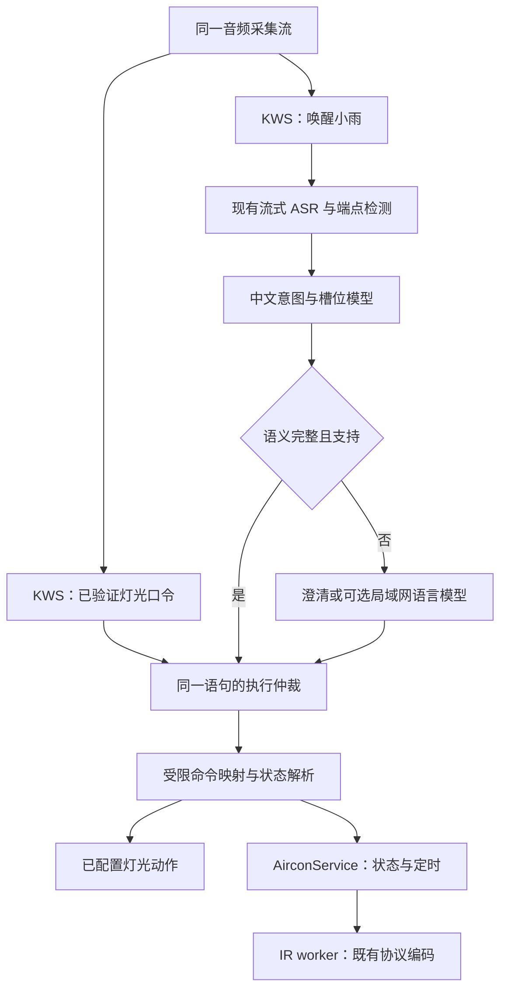

# MI6 语音设备控制：模型与硬件可行性

分析日期：2026-10-19。代码基线：`9cbcd8f`；本轮仅改 App 入口与目录，不改变语音执行逻辑。

## 结论与证据边界

可以同时保留快速开关灯并增加空调语言泛化。建议使用两条路径：灯光的已验证固定口令继续走 KWS；空调完整语句走现有流式 ASR，再交给小型中文意图/槽位模型，最终由现有 `AirconService` 执行。只有复杂、多轮或低置信输入才考虑更大的语言模型。全量换成大模型，既增加 MI6 负载，也不能解决采集、端点检测、推理锁和设备状态问题。

MI6 的 Hexagon 682 确实有神经网络计算路径，历史 TensorFlow Lite Hexagon delegate 明确列出 Snapdragon 835。但当前系统、运行库、模型形状、量化格式和权限能否组合成功，尚未通过模型推理验证。现代 QNN HTP/NPU 方案不能直接套到这台手机上。近期可以落地的基线是 CPU 上的小模型；DSP 是独立验证项，不应成为智能控制上线前置条件。[cite:1](#source-1)[cite:2](#source-2)[cite:3](#source-3)

证据分为“已确认代码/实机事实”“单一官方来源”“工程建议”“待验证”。以下没有使用其他设备的跑分推算 MI6 延迟，没有给新模型编造准确率或吞吐量。本轮没有下载或部署 NLU/LLM，也没有训练中文家居控制模型。

## 现有链路能做什么

| 层次 | 已确认的实现 | 影响 |
| --- | --- | --- |
| 音频采集 | APK `AudioRecord` → 私有 Unix socket → Rust voice worker | 权限与采集留在 App，不依赖浏览器打开 |
| 固定指令 | KWS 转写注册短语，`command_for_phrase()` 精确匹配后执行 HTTP 动作 | 开关灯可以绕过通用 ASR/NLU |
| 自然语句 | “小雨”唤醒，带预卷音频进入最长 6 秒 ASR 窗口 | 已能取到文本，无需从头建设识别链路 |
| ASR 结果 | `store_transcription_result()` 更新状态；结束后回到监听 | 自由文本当前不驱动设备，缺的是语义执行衔接 |
| 模型 | KWS 3.3M Zipformer、ASR 中文 14M Zipformer，INT8 文件；provider 为 CPU、单线程 | 这是当前配置，不等于 DSP 模型 |
| 空调动作 | 固定语音动作进入主服务；另有参数化 `AirconOperation` | 能复用服务端状态与定时，无须让模型生成红外码 |
| 竞争资源 | KWS、ASR、YOLO、TTS 使用跨进程推理锁 | 加模型前先控制长时间占锁 |

代码依据：[voice worker](../src/workers/voice.rs)、[voice 配置](../src/voice_config.rs)、[默认空调语音映射](../src/voice.rs)、[空调服务](../src/aircon.rs)、[推理锁](../src/inference_lock.rs)。sherpa 官方将 KWS 定义为对预设关键词的流式检测；它不是自由语言意图理解器。[cite:4](#source-4)

当前 `AirconState` 包含电源、温度、模式、ECO；API 支持绝对设置、开关、单项温度、相对调温、模式/ECO、取消任务，以及延迟/指定时间执行、自动关机。温度是 17–30°C 整数，ECO 仅适用于制冷。当前没有风速、摆风等可用槽位；即使模型理解“风小一点”，也不能声称已经执行。

旧 [NLU 文档](archive/voice-nlu-previous.md) 记录过规则解析器和小 LLM 设想；其中“红外还未参数化”“纯 LLM 每条 2–5 秒”等表述不能作为当前事实。规则路线曾因实际效果不佳回滚，后续应基于新评测集选择模型，而非继续增加同义词和正则分支。

## 快速口令与完整语义的分工



KWS 快路径只保留语义明确、已经验证的即时灯光口令。首次接入 NLU 时，不应让原有“开空调”前缀继续抢先执行：用户说“小雨开空调，调二十四度”，当前 KWS 可能先命中开机并返回，导致后续参数丢失。空调自由控制模式应等待句末；可显式区分快捷口令模式与自然控制模式，避免两条链路同时触发。

每次唤醒建立一个语句标识。快路径成功后取消该语句的其他候选；慢路径只处理尚未执行的语句。不能用“同时跑两套，哪个先返回就执行”处理否定、纠正、延迟命令，否则“别关灯”“十分钟后关灯”“先开空调，不对，关掉”会产生抢跑。

当前 ASR 端点参数为 `rule2_min_trailing_silence = 1.2`、`rule1_min_trailing_silence = 2.4`；6 秒是窗口上限，不是必须等满的延迟。应在真实口音和噪声下调节端点，关注“说完到发出动作”的延迟以及截断率。不能只看模型每秒处理多少音频。

快速执行也不等于所有场景下零等待。长句中包含短口令、否定词和自我纠正时，应优先避免错执行；在明确的短口令语法范围内才争取最短延迟。

## 模型选型

| 方案 | 优势 | 主要成本或缺口 | 对本项目的定位 |
| --- | --- | --- | --- |
| 继续扩大 KWS 短语表 | 不改变现有链路 | 不能稳定组合温度、时长、否定、上下文；维护量膨胀 | 仅用于灯光快路径 |
| ASR + 规则/语法解析 | 对已覆盖表达容易解释 | 改写、歧义和复合语句仍易退化成枚举 | 用作数值归一化与协议约束，不作为全部语义引擎 |
| ASR + MiniRBT 意图/槽位模型 | 小型编码器一次输出意图及多个参数；能学习表达变化 | 需要家居标注数据、任务微调和未知意图拒绝机制 | 推荐的本机长期方案 |
| ASR + 本机 Qwen3-0.6B 量化 | 可先用提示词验证自然语言到 JSON | MI6 延迟、内存、热稳定性未测；小模型不保证复杂语义 | 离线实验或受限兜底 |
| MI6 ASR + 局域网较大模型 | 避免手机生成模型占用；便于改善多轮理解 | 需要常开电脑/NAS，依赖网络 | 有常开算力时优先验证的广泛泛化方案 |

### 小型中文意图/槽位模型

推荐先评估 `hfl/minirbt-h256`：官方给出的结构为 6 层、隐藏维度 256、10.4M 参数；`minirbt-h288` 为 12.3M 参数，`rbt4-h312` 为 11.4M 参数。这些是预训练骨干，不是下载后即可控制空调的成品模型。官方公开的通用 NLP 任务成绩不能替代本家庭控制评测。[单一官方来源][cite:5](#source-5)

可在骨干上增加意图分类与 token 槽位标注头：句级输出设备域、操作类型；槽位标记温度、相对变化、模式、ECO、时长和目标设备。联合意图识别/槽位填充有公开 BERT 方法依据，但公开基准任务的成绩不是中文家居领域的保证。[cite:6](#source-6)

“把空调调成二十四度”“空调温度设为24”“屋里空调改到二十四”应归一为同一操作。温度与时间从文本槽位提取后再转换为整数/分钟；规则只做数字和单位解析、范围校验及状态合并，不承担全部自然语言理解。多种意图共存时，应支持受限组合或请求用户拆分，不能强行归入一个分类。

训练应在电脑上完成，导出 ONNX 后复用 Android 现有 ORT CPU 运行库；固定最大输入长度，验证 tokenizer 一致性，并对量化前后逐样本比较。优先实现一个受限语言域，不先建设通用聊天系统。按模型许可证和确切权重版本建立下载校验信息。

数据应包含真实说法、不同说话人、近音数字、否定、纠正、不同房间、无关对话及失败 ASR 文本。训练/验证/测试按表达模板与说话人隔离；同一句话仅替换温度后分到不同集合会高估泛化。教师模型可辅助提出改写，但执行标签必须人工确认；测试集保持独立真实数据。

置信度不应仅取最大 softmax 值后就执行。验证集需要校准拒绝阈值，并同时评估“意图正确”“所有槽位正确”“设备目标正确”“拒绝是否正确”。“太热了”可能是抱怨，也可能是调温请求；缺少约定时应询问，而不是自动开到最低温度。

### 语言模型方案

Qwen3-0.6B 官方权重为 0.6B 参数，支持关闭 thinking。可采用 llama.cpp 与经过校验的量化权重，仅让它输出短命令对象，固定短上下文、限制输出长度，并启用非思考模式。不能把官方的大上下文能力当作 MI6 应当配置的默认值。[cite:7](#source-7)

`llama.cpp` 的 GBNF / JSON schema 约束能限制输出结构，但不能保证“调高两度”与“调低两度”理解正确，也不会补足不存在的设备能力。必须保留命令白名单、参数校验、目标解析和拒绝结果；禁止输出任意 URL、shell 或红外波形。约束只负责语法，执行器负责产品语义。[cite:8](#source-8)

本机 0.6B 适合先做文本离线回放，不能提前承诺流畅多轮对话。若已有常开电脑，先将同一受限命令 schema 接到局域网较大模型，更容易验证“泛化是否值得”；本地灯光快路径独立运行，远端超时就报告未执行，不能在旧请求回来时补发设备动作。此路线需要新增配置和鉴权，本轮未接入任何外部模型服务，也未发送录音。

ASR 若无法准确识别数字、房间名和否定词，后续模型再好也会误解。可用 SenseVoiceSmall 做中文离线识别对照；它有中文识别和 ONNX 导出支持，但并非当前流式 Zipformer 的无成本替换。需要改变端点/分段策略并测内存、热负载、数字错误率，不能将其公开 GPU 或其他设备速度直接套到 MI6。[cite:9](#source-9)

## 命令与空调状态边界

以下是推荐的语义映射示例，不是已实现的新功能：

| 用户表达 | 应产生的语义 | 当前 API 的承接方式 |
| --- | --- | --- |
| 小雨开灯 | 立即打开指定灯 | 复用配置的 `light-on` 动作 |
| 空调调到二十四度 | 绝对设温 | `set_temperature`，`temperature_c: 24` |
| 空调再凉两度 | 相对降低设定温度 | `adjust_temperature`，`delta_c: -2`；需可靠的当前设定基准 |
| 制冷二十四度，两个小时后关 | 制冷设温 + 自动关机 | `set` 加 `auto_off_minutes: 120`；ECO 未指定时按已定义状态策略处理 |
| 十分钟后关空调 | 延迟执行关机 | `off` 加 `delay_minutes: 10` |
| 把风调小一点 | 风速调整 | 当前 API 无风速能力，应明确告知不支持 |
| 不要关灯 | 否定动作 | 不执行，而非匹配“关灯”子串 |
| 房间太热了 | 状态描述/隐含请求 | 缺少产品约定时询问温度或操作 |

已可接受的 JSON 形状示例：

```json
{
  "command": {"operation": "set_temperature", "temperature_c": 24},
  "request_id": "utterance-42",
  "delay_minutes": null,
  "execute_at_epoch": null,
  "auto_off_minutes": 120
}
```

这一请求的语义是“设定24度并在120分钟后关机”，其他状态按服务逻辑继承。当前 `SetTemperature` 会同时打开电源，`SetMode` 也会打开电源；若产品想支持“保持关机但预设温度”，需要先改明确的 API 语义，不能让 NLU 自行承诺。

`request_id` 字段存在不等于所有即时动作已经幂等。当前代码的去重主要在定时创建分支；接入可重试的模型通道时，必须补足语句级去重，尤其是相对调温，避免一次请求重试变成连续降温。

空调红外是单向发送，`AirconState` 记录最后发送的影子状态，不是传感器反馈。用户用原遥控器调温后，“再凉两度”可能基于陈旧值。可采用“按上次设置调节”的明确交互、状态有效期、无基准时询问绝对温度；如果需要真实状态一致性，应接入设备协议或独立反馈。增加语言模型不能解决物理状态不可观测。

“更凉一点”也不应完全等于“温度数值减一”：在制热/除湿模式、关机状态和不同房间下可能需要不同决策。第一版只支持明确的设备、温度和模式组合，隐含偏好后续再引入用户可理解的规则。

## MI6 硬件与加速路径

### 实机与官方资料

实机只读探测确认：型号 `MI 6`、平台 `msm8998`、Android 9/API 28；存在 `/vendor/lib64/libadsprpc.so`、`libcdsprpc.so`、`/dev/adsprpc-smd`、`/vendor/lib64/libOpenCL.so` 和 `vulkan.msm8998.so`。DSP 节点显示为 `system:system`、`crw-rw-r--`。文件存在只证明系统安装了组件，不证明 App UID 能访问并执行模型。

本次 `lshal`/vendor manifest 搜索没有发现 neuralnetworks 项，`dumpsys neuralnetworks` 返回 `Can't find service: neuralnetworks`。这些是辅助线索，不是 NNAPI runtime 设备枚举的替代，更不能据此断言系统完全没有 NNAPI。API 28 无 Android 10 才引入的完整设备发现/指派能力。[cite:10](#source-10)

Qualcomm 官方规格列出 Adreno 540、Hexagon 682/HVX。应按“旧代 DSP + GPU”评估，而不是将 MI6 当作支持现代 HTP 的新 Snapdragon NPU 手机。Google 的历史 delegate 支持列表与 Qualcomm 原始资料互相印证 DSP 计算路径；真实模型可用性仍待实机验证。[cite:1](#source-1)[cite:2](#source-2)[cite:11](#source-11)

| 路径 | 支持证据与限制 | 本项目建议 |
| --- | --- | --- |
| ORT CPU | 当前已经使用；无需新驱动 | 首选：小型语义模型、现有 KWS/ASR |
| TFLite Hexagon delegate | 历史官方列表包含 835/682；要求匹配的量化图、支持算子、DSP skeleton 与 runtime | 可做单独 PoC，先官方支持的小模型再目标模型 |
| 旧 SNPE DSP | Qualcomm 官方曾为 835 提供异构推理方案 | 需要匹配的旧 SDK、支持矩阵、运行库及许可；不默认最新 QAIRT 支持 |
| ORT QNN HTP | 官方文档测试平台列举 SM8350、SC8280、Snapdragon X，并非 MSM8998 | 不作为 MI6 上线方案；SM8350 与“Snapdragon 835”不是同一芯片 |
| ORT NNAPI | 系统版本满足最低要求；是否硬件执行取决于驱动和算子 | 仅做对照试验，不能用 provider 名称证明 DSP 已启用 |
| ncnn/Vulkan GPU | 有驱动文件，ncnn 支持 Android Vulkan；旧驱动可能出错，CPU 回退可能更慢 | 优先对固定图的视觉模型做对照；语音 Transformer 单独评估 |

QNN 文档要求处理动态 shape 和算子支持，HTP 路线还涉及量化模型；既有 ONNX 文件名带 INT8，不保证其量化算子与 DSP 后端兼容。Zipformer 的 encoder/decoder/joiner、缓存状态和动态算子都需要逐一分析，不能简单把 `provider="cpu"` 替换为 DSP 字符串。[cite:3](#source-3)

NNAPI 从 Android 15 开始废弃，但这不意味着 Android 9 的旧接口立即不可用。对 MI6 更现实的问题是驱动和 fallback：ORT 的 `NNAPI_FLAG_CPU_DISABLED` 仅在 API 29+ 有效，在当前 API 28 会被忽略。看到执行成功可能仍是 CPU；需要图分区、日志及真实耗时/功耗证据。[cite:12](#source-12)[cite:10](#source-10)

DSP 更适合优先探索固定图的量化小型 KWS/CNN，而不是先搬完整自回归 LLM。ncnn 官方也明确提醒移动 GPU 可能比优化过的 ARM CPU 慢；数据搬运、kernel 调度、部分算子回退都会抵消收益。对 10M 级短文本 NLU，CPU 通常是更容易验证和维护的起点，但 MI6 上是否足够快仍需测量。[cite:2](#source-2)[cite:13](#source-13)

另外，“DSP 执行了 KWS 网络”不等于“Android 可以低功耗常驻监听”。音频仍由 CPU/AudioRecord 提供时，采集唤醒和拷贝成本仍在；OEM 低功耗唤醒音频通道不是任意第三方 App 都能获取。不能把模型迁移直接承诺为整机续航提升。

### 加速试验的通过条件

首先在正式 App UID、同一 Android 版本、相同 ABI 下跑受支持的最小模型，验证 DSP 库能加载且目标子图确实下放。随后再转换一个目标模型，比较同一输入的输出误差、命中率、首次加载与热运行延迟、CPU 使用、温度以及并发录像稳定性。root shell 能运行不足以代表 APK 可用。

只有“执行后端有证据、结果一致、整条控制链路收益明显、不会破坏现有功能”才合入。若图频繁分区回退、必须依赖不可分发的旧库或只能在 root 身份下运行，就停止该路线。不要先把整个项目迁移到某个加速框架。

## 落地顺序与验收

第一步：建立真实口令回放基线。分别记录音频到达、KWS 命中、ASR 端点、文本完成、NLU 完成、动作发出和播报开始。拆分“听得准”“理解对”“执行快”，包含无人声、电视声和不同距离，结果按场景统计 P50/P95、误触发、漏识别和整句命令准确率。

第二步：离线比对三种语义候选：当前固定/规则基线、微调 MiniRBT、受限 JSON 的语言模型。先直接输入人工转写文本，再输入真实 ASR 文本，区分识别错误和理解错误。硬件速度测试需同时打开实际录像、AI 和语音负载；只测空载无法代表 MI6 日常体验。

第三步：先以“只展示识别命令”的旁路接入，不执行动作。检查否定、长句前缀、定时、ECO/模式冲突、无风速能力、陈旧状态、重复请求和模型超时。满足家庭实际使用要求后，再接 `AirconService`；第一版避免任意多设备批处理。

第四步：保障快速灯光通道。短确认回复预生成或使用已有缓存，动态 TTS 不阻挡动作发送；长 TTS/LLM 不得在当前全局锁内运行整个生成过程。可优先限制低优先级工作，或将重模型移至常开电脑，而非直接删除推理锁、让所有模型无约束争抢。

第五步：仅在 CPU 实测达不到需求时投入硬件适配。DSP 先做固定小图验证；视觉模型可另测 ncnn/Vulkan。通用空调理解若需要较大模型，常开电脑或更新且确认有工具链支持的计算节点，比为 835 维护旧 DSP 栈更容易交付。

最近可实施的功能增量是：**保留灯光 KWS → 为空调自然语句接小型 NLU → 输出既有命令 schema → 状态/时效/去重检查 → 复用当前红外执行器**。训练数据不足时，先以局域网模型验证语义与收集纠错，再决定是否蒸馏到手机；不提前承诺纯本机大模型速度。

## 来源

外部资料访问日期均为 2026-10-19。模型参数与特性以其官方页面为准；芯片历史支持不等于当前 MIUI 和 APK 已适配。

<a id="source-1"></a>
[cite:1] Qualcomm，TensorFlow on Snapdragon 835 and Hexagon 682（2017）：https://www.qualcomm.com/news/onq/2017/01/tensorflow-machine-learning-now-optimized-snapdragon-835-and-hexagon-682-dsp

<a id="source-2"></a>
[cite:2] TensorFlow 官方，Hexagon delegate（2019；历史支持与量化限制）：https://blog.tensorflow.org/2019/12/accelerating-tensorflow-lite-on-qualcomm.html

<a id="source-3"></a>
[cite:3] ONNX Runtime，QNN EP 支持、模型约束与后端配置：https://onnxruntime.ai/docs/execution-providers/QNN-ExecutionProvider.html

<a id="source-4"></a>
[cite:4] sherpa-onnx，Keyword Spotting：https://k2-fsa.github.io/sherpa/onnx/javascript-api/examples/keyword_spotter.html

<a id="source-5"></a>
[cite:5] 哈工大讯飞联合实验室，MiniRBT 官方模型与微调说明：https://github.com/iflytek/MiniRBT

<a id="source-6"></a>
[cite:6] Chen 等，BERT for Joint Intent Classification and Slot Filling：https://arxiv.org/pdf/1902.10909.pdf

<a id="source-7"></a>
[cite:7] Qwen，Qwen3-0.6B 模型卡：https://huggingface.co/Qwen/Qwen3-0.6B

<a id="source-8"></a>
[cite:8] llama.cpp，GBNF 与 JSON Schema 限制：https://github.com/ggml-org/llama.cpp/blob/master/grammars/README.md

<a id="source-9"></a>
[cite:9] SenseVoice 官方项目，识别能力、导出与部署范围：https://github.com/FunAudioLLM/SenseVoice

<a id="source-10"></a>
[cite:10] Android Open Source Project，NNAPI device discovery / assignment：https://source.android.google.cn/docs/core/interaction/neural-networks/device-discovery

<a id="source-11"></a>
[cite:11] Qualcomm，Snapdragon 835 官方产品说明：https://www.qualcomm.com/content/dam/qcomm-martech/dm-assets/documents/snapdragon_product_brief_835_0.pdf

<a id="source-12"></a>
[cite:12] ONNX Runtime，NNAPI EP 与 API 28 上的 CPU fallback 限制：https://onnxruntime.ai/docs/execution-providers/NNAPI-ExecutionProvider.html

<a id="source-13"></a>
[cite:13] ncnn 官方，Vulkan 支持、CPU fallback 与移动 GPU 性能边界：https://github.com/Tencent/ncnn/wiki/FAQ-ncnn-vulkan
